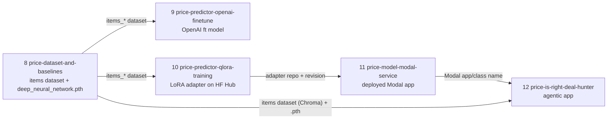

# LLM Engineering – Projects Index

Twelve independently runnable projects for learning AI and LLM engineering, from first API
calls to RAG, fine-tuning and autonomous agents. Each folder is self-contained: its own
`README.md`, `pyproject.toml`, `.env.example`, tests (offline, mocked LLM clients) and
`docs/lld-design.md` (low-level design with Mermaid diagrams). No project imports another;
the only links between them are **artifacts** (datasets, weights, a deployed Modal app) that
are passed by configuration.

```bash
cd <project> && uv venv && uv pip install -e ".[dev]"   # then see the project README
cp .env.example .env                                     # add your keys
```

| # | Project | Topic | Needs |
|---|---------|---------------|-------|
| 1 | [webpage-summarizer](webpage-summarizer) | Prompting, local models | OpenAI key or Ollama |
| 2 | [company-brochure-generator](company-brochure-generator) | Multi-step LLM pipelines, streaming UI | OpenAI / Anthropic / Gemini / Ollama |
| 3 | [llm-debate-arena](llm-debate-arena) | Multi-provider APIs, caching | Any of 8 providers |
| 4 | [airline-ai-assistant](airline-ai-assistant) | Chatbots, tool calling, multimodal | OpenAI (Ollama for chat only) |
| 5 | [meeting-minutes-creator](meeting-minutes-creator) | Open-source models, speech | GPU, or OpenAI fallback |
| 6 | [code-generator](code-generator) | Code generation | Any LLM + C++/Rust compiler |
| 7 | [rag-knowledge-assistant](rag-knowledge-assistant) | RAG | OpenAI (HF embeddings optional) |
| 8 | [price-dataset-and-baselines](price-dataset-and-baselines) | Datasets, baselines, neural nets | HF token; GPU optional |
| 9 | [price-predictor-openai-finetune](price-predictor-openai-finetune) | Hosted fine-tuning | OpenAI key |
| 10 | [price-predictor-qlora-training](price-predictor-qlora-training) | QLoRA fine-tuning | CUDA GPU (Colab T4+), HF token |
| 11 | [price-model-modal-service](price-model-modal-service) | Serverless model serving | Modal account |
| 12 | [price-is-right-deal-hunter](price-is-right-deal-hunter) | Agentic systems | OpenAI; Modal/NN optional |

---

## Prompting, APIs, UIs and tools

### 1. webpage-summarizer
Scrapes a web page (requests + BeautifulSoup) and asks an LLM for a markdown summary.
Backend is switchable between OpenAI and any OpenAI-compatible endpoint such as Ollama.
Run: `webpage-summarizer https://example.com --backend ollama` or add `--ui` for Gradio.

### 2. company-brochure-generator
Two-step pipeline. The LLM first picks the relevant links on a company site as JSON
(About, Careers, ...), then writes a streamed brochure from the landing page plus those pages.
Gradio UI with a model dropdown (GPT, Claude, Gemini, Ollama) and a tone selector.
Run: `brochure-generator "Acme" https://acme.com --model Claude` or `--ui`.

### 3. llm-debate-arena
Runs conversations between N chatbots from different providers (presets `classic`, `local`,
`roundtable`), side-by-side model comparison with cost and reasoning-effort options, and the
Hamlet prompt-caching experiment through litellm.
Run: `debate-arena run|compare|cache-demo|presets|ui`.

### 4. airline-ai-assistant
Gradio chatbot for a fictional airline. A `ToolRegistry` pairs tool schemas with handlers
(`get_ticket_price`, `book_ticket`; `set_ticket_price` is admin-only behind
`ENABLE_ADMIN_TOOLS=1`), with a capped tool-call loop. Adds city image generation and
text-to-speech. Run: `airline-assistant` (UI) or `airline-assistant --chat` (terminal).

## Open-source models and code generation

### 5. meeting-minutes-creator
Audio in, structured markdown minutes out. Local backend: Whisper plus 4-bit Llama via HF
Transformers. API backend: OpenAI `whisper-1` plus a chat model. `BACKEND=auto` picks local
only if CUDA exists. CLI `meeting-minutes`, Gradio UI that also accepts pasted transcripts,
and `docs/concepts.md` covering GPU setup on Colab, pipelines, tokenizers, quantization).

### 6. code-generator
Converts Python to optimized C++ or Rust with a choice of nine models, then compiles and runs
both versions and shows the speedup. Compile commands come from a system probe.
Generated code runs in a child process with a timeout, but it is still untrusted code, so read
the security note in its README. Run: `code-generator ui|info|port FILE --run`.

## RAG

### 7. rag-knowledge-assistant
Expert assistant over the fictional "Insurellm" knowledge base (bundled in `data/`).
Two selectable pipelines: **basic** (LangChain splitters, MiniLM or OpenAI embeddings, Chroma,
top-k retrieval) and **pro** (LLM semantic chunking, query rewriting, multi-retrieval, LLM
rerank). Includes an evaluation harness (MRR, nDCG, keyword coverage, LLM-as-judge) with a
dashboard over 150 test questions, a chat UI, and a t-SNE vector visualization.
Run: `rag ingest|ask|chat|eval|viz`.

## Capstone: "The Price Is Right" (price prediction and deal hunting)

Products are priced from their text descriptions. Models are **trained first (projects 8–10)**
and **used later (projects 11–12)**. The training projects are separate on purpose; each
serving project's README and LLD has a *Prerequisites: how the models are trained* section.



### 8. price-dataset-and-baselines (training)
Curates the Amazon product dataset and pushes it to the HF Hub, then benchmarks everything
that is not an LLM fine-tune: random, constant, linear regression, bag-of-words, random
forest, XGBoost, a human baseline, frontier models zero-shot, and a deep neural network.
CLIs: `curate-items`, `summarize-items`, `run-baselines`, `human-baseline`, `train-dnn`,
`eval-dnn`, `eval-frontier`.
**Produces:** HF datasets `<HF_USERNAME>/items_{full,lite}` (and `items_raw_*`), plus
`deep_neural_network.pth` with a `.meta.json` sidecar holding `y_mean`/`y_std`.

### 9. price-predictor-openai-finetune (training)
Builds chat-format JSONL from the items dataset, launches an OpenAI fine-tuning job on
`gpt-4.1-nano`, monitors it, and compares fine-tuned against the base model.
CLI `openai-ft prepare|launch|status|evaluate|compare`.
**Consumes:** project 8's dataset. **Produces:** a private `ft:gpt-4.1-nano...` model id.

### 10. price-predictor-qlora-training (training)
Fine-tunes Llama 3.2 3B with 4-bit QLoRA (PEFT and TRL's SFTTrainer), with a quantization
comparison, evaluation and inference scripts. The README covers the Colab/GPU path.
CLIs: `qlora-prepare-prompts`, `qlora-quant-compare`, `qlora-train` (has `--dry-run`),
`qlora-evaluate`, `qlora-infer`.
**Consumes:** project 8's dataset. **Produces:** HF dataset `items_prompts_*` and a LoRA
adapter repo `<HF_USERNAME>/price-<timestamp>` with one git revision per checkpoint.

### 11. price-model-modal-service (serving)
Deploys the fine-tuned Llama pricer as a serverless GPU service on Modal. Includes the
a step-by-step ladder (hello, a Llama smoke test, an ephemeral app), the deployed `Pricer` class,
a client with retries and warm/cool controls, and a CLI:
`price-model config|deploy|price|preprocess|warm|cool|run-ephemeral`.
**Prerequisite:** project 10 (the adapter). Fallbacks: `BASE_ONLY=1`, or a `mock` client.

### 12. price-is-right-deal-hunter (serving)
Autonomous multi-agent system. It scans deal RSS feeds, estimates each item's true price with
an ensemble (Modal specialist, RAG frontier agent over Chroma, deep neural network), and sends
a Pushover notification for good deals. A planning agent (including a tool-calling autonomous
variant) orchestrates the steps. The Gradio UI shows live colour-coded logs, a 3D t-SNE plot
and a timer. CLI `deal-hunter ui|run-once|build-vectorstore|agent ...|reset-memory|check`.
**Prerequisites:** project 8 (items dataset and `.pth`) and projects 10 and 11 (adapter and
Modal service). Fallbacks: `SPECIALIST_BACKEND=mock`, per-agent `ENABLE_*` flags, and a fully
offline `ui --demo`.

---

## Caveats that apply across the set

- **Tests are offline.** Every project's tests pass with mocked clients. Live LLM calls,
  Modal deployment, GPU training, scraping and Pushover delivery were **not** run when these
  projects were built, so expect to debug the first real run.
- **Some code is reconstructed.** The meeting-minutes app and the QLoRA training project were
  implemented from the standard approach, so their hyper-parameters are common defaults to
  tune for your own data.
- **Pre-built resources.** The price projects default to private Hugging Face datasets
  (you need `HF_TOKEN` or `hf auth login` to read them) and adapter under the `rampangeni/` namespace; change `HF_USERNAME` (and the related variables) to use another namespace.
- **Model ids drift.** Names such as `gpt-5.1` or `gemini-3.1-flash-lite` are overridable via
  environment variables.
- **Gradio is pinned below 6** in the UI projects, so they need a 5.x install.
- Cost, time and VRAM figures in the training docs are estimates, not measurements.
