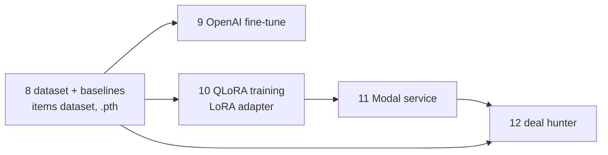

# LLM Engineering Projects

Twelve independently runnable projects for learning AI and LLM engineering, from first API calls
to RAG, fine-tuning, serverless model serving and autonomous agents.

Each project is self-contained: its own `README.md`, `pyproject.toml`, `.env.example`, offline tests
(mocked LLM clients) and `docs/lld-design.md` (low-level design with Mermaid diagrams). No project
imports another. The only links between them are artifacts (datasets, weights, a deployed Modal app)
that are passed by configuration.

For a longer description of every project, see [PROJECTS.md](PROJECTS.md).

## Projects

| # | Project | Topic | Needs |
|---|---------|-------|-------|
| 1 | [webpage-summarizer](webpage-summarizer) | Prompting, local models | OpenAI key or Ollama |
| 2 | [company-brochure-generator](company-brochure-generator) | Multi-step LLM pipelines, streaming UI | OpenAI / Anthropic / Gemini / Ollama |
| 3 | [llm-debate-arena](llm-debate-arena) | Multi-provider APIs, caching | Any of 8 providers |
| 4 | [airline-ai-assistant](airline-ai-assistant) | Chatbots, tool calling, multimodal | OpenAI (Ollama for chat only) |
| 5 | [meeting-minutes-creator](meeting-minutes-creator) | Open-source models, speech | GPU, or OpenAI fallback |
| 6 | [code-generator](code-generator) | Code generation | Any LLM + C++/Rust compiler |
| 7 | [rag-knowledge-assistant](rag-knowledge-assistant) | RAG | OpenAI (HF embeddings optional) |
| 8 | [price-dataset-and-baselines](price-dataset-and-baselines) | Datasets, baselines, neural nets | HF token; GPU optional |
| 9 | [price-predictor-openai-finetune](price-predictor-openai-finetune) | Hosted fine-tuning | OpenAI key |
| 10 | [price-predictor-qlora-training](price-predictor-qlora-training) | QLoRA fine-tuning | CUDA GPU (Colab T4+), HF token |
| 11 | [price-model-modal-service](price-model-modal-service) | Serverless model serving | Modal account |
| 12 | [price-is-right-deal-hunter](price-is-right-deal-hunter) | Agentic systems | OpenAI; Modal/NN optional |

Projects 8–12 form the **"The Price Is Right"** capstone. The models are trained first (8–10) and used
later (11–12):



## Quick start

Every project follows the same setup (requires [uv](https://docs.astral.sh/uv/)):

```bash
cd <project>
uv venv && uv pip install -e ".[dev]"
cp .env.example .env     # add your API keys
```

Then follow the project's own README for its CLI or UI. Tests run offline:

```bash
pytest
```

## Caveats

- Tests use mocked clients. Live LLM calls, Modal deployment, GPU training, scraping and Pushover
  delivery were not run when these projects were built, so expect to debug the first real run.
- The price projects default to private Hugging Face datasets and adapters under the `rampangeni/`
  namespace. Set `HF_USERNAME` (and related variables) to use your own.
- Model ids drift. Names such as `gpt-5.1` are overridable through environment variables.
- Gradio is pinned below 6 in the UI projects.
- Never commit `.env` files. They are git-ignored; only `.env.example` is tracked.
