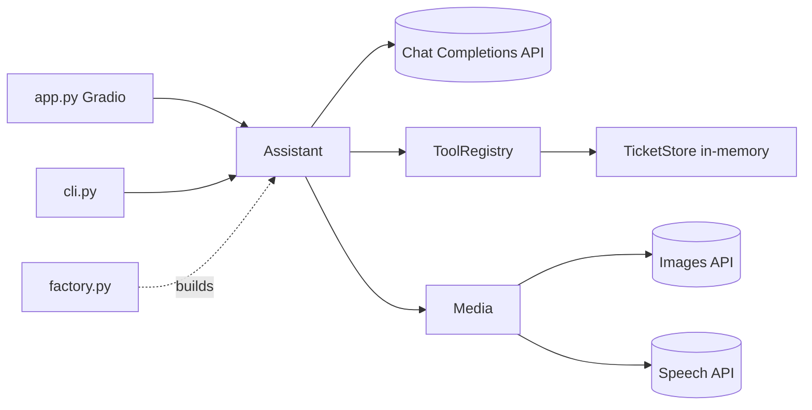
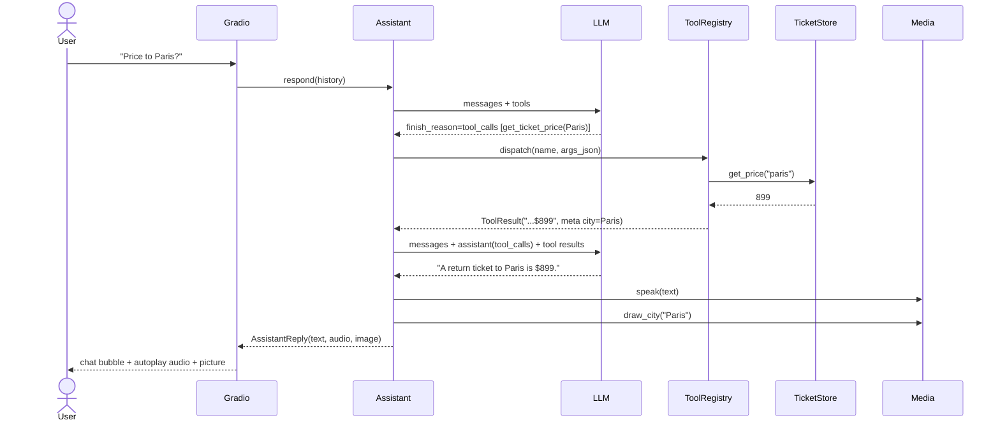

# FlightAI Airline Assistant - Low-Level Design

## 1. Purpose and scope
Demonstrate the progression from a plain system-prompted chatbot to a tool-using, multimodal assistant: the LLM decides when to call functions (price lookup, booking), the app executes them and feeds results back, and the UI additionally shows a generated city image and plays the reply as speech.
Out of scope: real payments/authentication, persistent database, streaming responses, speech input.

## 2. Requirements
- F1 Gradio chat with a business system prompt.
- F2 Function calling: `get_ticket_price`, `book_ticket`, optional admin `set_ticket_price`; parallel calls; repeated tool rounds.
- F3 In-memory ticket DB with price table and booking records.
- F4 City image and TTS for each reply; failures never break the chat.
- F5 OpenAI default; Ollama for text/tools.
- N1 Offline tests via fake client; no hardcoded credentials; admin write tool disabled by default.

## 3. Components
| Module | Responsibility |
|---|---|
| `config.py` | `Settings`, `load_settings`, `make_client` |
| `tickets.py` | `TicketStore`, `Booking`, `TicketError`, `money` |
| `tools.py` | `Tool`, `ToolResult`, `ToolRegistry`, `build_default_registry` |
| `assistant.py` | `Assistant.complete` (tool loop), `Assistant.respond` (adds media), `SYSTEM_PROMPT` |
| `media.py` | `Media.draw_city`, `Media.speak` |
| `factory.py` | wiring `build_assistant` |
| `app.py`, `cli.py` | Gradio Blocks UI / terminal chat |



## 4. Signatures and data models
```python
@dataclass Booking(ticket_id, passenger, city, price)
class TicketStore: get_price(city)->float|None; set_price(city, price); book(city, passenger)->Booking; bookings(); destinations()
@dataclass ToolResult(content: str, meta: dict)          # meta["city"] drives the image
@dataclass Tool(name, description, parameters(JSON schema), handler, admin_only=False)
class ToolRegistry: register(tool); schemas()->list; names(); dispatch(name, arguments_json)->ToolResult  # never raises
class Assistant: complete(history)->(text, cities); respond(history)->AssistantReply(text, cities, image, audio)
class Media: draw_city(city)->PIL.Image|None; speak(text)->bytes|None
```
History is the Gradio "messages" format: `[{"role","content"}, ...]`.

## 5. Main flow

The loop repeats while `finish_reason == "tool_calls"` (a plain `while` loop), capped at `MAX_TOOL_ROUNDS = 5` to avoid runaway cost.

## 6. Prompts and why
- **System prompt**: role (FlightAI support), brevity (1 sentence - also keeps TTS cheap), honesty ("if you don't know, say so"). We add two lines: use tools instead of guessing prices, and collect city + passenger name before booking, which prevents the model booking with made-up data.
- **Tool descriptions**: `get_ticket_price` "price of a return ticket to the destination city"; `book_ticket` states the precondition; `set_ticket_price` is prefixed ADMIN.
- **Image prompt**: "An image representing a vacation in {city}, showing tourist spots and everything unique about {city}, in a vibrant pop-art style".
- **TTS**: model `gpt-4o-mini-tts`, voice `onyx` (configurable).

## 7. Tool registry design
Schema and handler live in one `Tool` object so they cannot drift. `dispatch` is the single execution point: it parses JSON arguments, calls the handler with kwargs, and converts `TicketError`, bad JSON, missing/extra args and unknown tools into `"Error: ..."` strings returned as the tool message, letting the model recover (ask the user for a missing name, say we don't fly somewhere). Admin tools are filtered out of both `schemas()` and `dispatch` unless enabled, so the model can neither see nor invoke them.
Adding a tool: build a `Tool(...)`, `registry.register(...)`.

## 8. Error handling
- Tool errors -> text to model (above). Unknown city price -> "Unknown ticket price".
- Media failures -> `None` + console message; chat continues.
- API failure in UI handler -> apologetic message in the chat.
- Missing key -> `RuntimeError` at startup; CLI prints and exits 1.
- Concurrency: `TicketStore` uses a lock; Gradio runs handlers in threads.

## 9. Configuration
`ASSISTANT_BACKEND`, `OPENAI_API_KEY`, `OPENAI_MODEL` (gpt-4.1-mini), `OLLAMA_MODEL`, `OLLAMA_BASE_URL`, `IMAGE_MODEL`, `TTS_MODEL`, `TTS_VOICE`, `ENABLE_ADMIN_TOOLS`, `GRADIO_USER`/`GRADIO_PASSWORD`.

## 10. External dependencies
openai, gradio, pillow, python-dotenv.

## 11. Extensibility
- Swap `TicketStore` for sqlite (a `prices` table) behind the same methods.
- New tools via registry; new media (e.g. speech input) in `media.py`.
- Streaming: replace `complete`'s final call with `stream=True` and yield text.
- Persist bookings; add auth to booking.

## 12. Limitations and cost
- Each user turn = 1+ chat calls + 1 TTS call + (when a city was used) 1 image call; image generation is the dominant cost and latency (seconds).
- Prices/bookings reset on restart and are shared by all browser sessions (single global store).
- The LLM can be talked into booking; real systems need server-side confirmation and auth.
- Image/TTS model names and access may change.

## 13. Prerequisites: how the models are trained
Not trained here - the assistant uses hosted pre-trained chat, image and TTS models (and optionally a local Ollama model). Function calling ability comes from instruction/tool-use fine-tuning of the base chat models; see the sibling fine-tuning projects for how such tuning is done.
