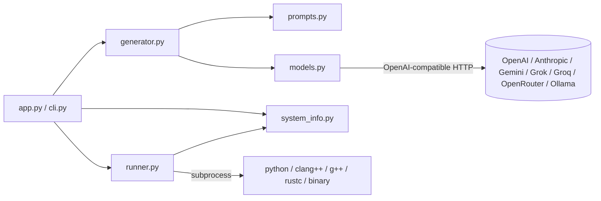
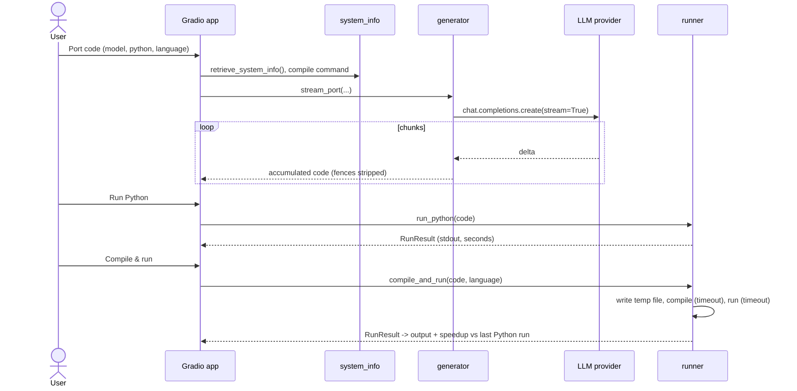

# code-generator: Low-Level Design

## 1. Purpose and scope
Take a Python program, ask an LLM to port it to C++ or Rust optimised for speed and *identical output*, compile and
run both, and report runtime/speedup. Scope: single-file programs printing to stdout. Out of scope: multi-file
projects, FFI, automated output-equivalence proof (user compares outputs).

## 2. Requirements
- F1 Select among multiple providers/models. F2 Stream output. F3 Target C++ or Rust.
- F4 Detect OS/CPU/compilers and derive compile flags. F5 Run Python and native code, show time/speedup.
- F6 Sample programs. F7 UI + CLI.
- N1 No secrets in code (`python-dotenv`). N2 Tests run offline. N3 Execution is bounded (timeouts) and documented as unsafe.

## 3. Components
| Module | Responsibility |
|---|---|
| `models.py` | `ModelSpec`, default model list, `make_client(provider)` (OpenAI SDK + base_url) |
| `prompts.py` | system/user prompt builders, language metadata |
| `generator.py` | `stream_port`, `port`, `strip_fences` |
| `system_info.py` | `retrieve_system_info`, `rust_toolchain_info`, `pick_cpp_compile_command`, `pick_rust_compile_command` |
| `runner.py` | `run_python`, `compile_and_run`, `speedup`, env scrubbing, timeouts |
| `samples.py` + `samples/` | sample programs |
| `styles.py` | Gradio CSS |
| `app.py` | `build_ui`, event handlers |
| `cli.py` | argparse front end |



## 4. Data models and signatures
```python
@dataclass(frozen=True) class ModelSpec: name: str; provider: str; reasoning_effort: str | None
@dataclass class RunResult: ok: bool; output: str; seconds: float   # .render()

def make_client(provider: str) -> OpenAI
def messages_for(python, language, compile_command, system_info=None) -> list[dict]
def stream_port(model, python, language, compile_command, system_info=None, client_factory=make_client) -> Iterator[str]
def run_python(code, timeout=None) -> RunResult
def compile_and_run(code, language, compile_command=None, timeout=None) -> RunResult
def pick_cpp_compile_command(info=None, source="main.cpp", output="main") -> list[str]
def pick_rust_compile_command(source="main.rs", output="main") -> list[str]
def speedup(python_seconds, native_seconds) -> float | None
```

## 5. Main flows


## 6. Prompts
System prompt demands *only code* and *identical output in the fastest possible time*.
The user prompt includes the Python, the machine report (so the model can use e.g. SIMD/-march features) and the
exact compile command (so the model knows the flags/optimisation level, e.g. `-Ofast`, `lto=fat`, `panic=abort`).
Why: experiments show that giving the compiler context yields much faster code; "only code" makes the
reply directly compilable after fence stripping. Prompt-hardening note: "support large numbers" comment in the hard
sample is what steers models to 64-bit/wrapping integer arithmetic.

## 7. Error handling
- Missing API key -> `RuntimeError` surfaced into the code pane as `// Error: ...`.
- No compiler -> `RunResult(ok=False, "No C++ compiler found...")`.
- Compile error / non-zero exit -> stderr shown. Timeouts -> message, process killed.
- Streaming chunks without `choices` (keep-alives, usage chunks) are ignored.

## 8. Configuration
Env (via `.env`): provider keys, `OLLAMA_BASE_URL`, `OPENAI_MODEL`, `CLAUDE_MODEL`, `GROK_MODEL`, `GEMINI_MODEL`,
`RUN_TIMEOUT` (60), `COMPILE_TIMEOUT` (120). Model list: edit `default_models()`.

## 9. Security
Generated code is untrusted. Mitigations: temp cwd, `shell=False`, timeouts, env scrubbed of `*KEY*/*TOKEN*/*SECRET*/*PASSWORD*`.
Not mitigated: filesystem access, network, CPU/memory use, fork bombs. Recommend containerisation. Python is run in a
child interpreter (in-process `exec` could crash/hang the UI).

## 10. External dependencies
`openai`, `python-dotenv`, `gradio` (>=5,<6, since the `Blocks(css=, theme=)` API changed in 6), system
compilers, optionally Ollama.

## 11. Extensibility
Add a provider: entry in `BASE_URLS`/`KEY_ENV` + `ModelSpec`. Add a language: entry in `LANGUAGES`, a
`pick_*_compile_command`, and a branch in `compile_command_for`. Add output-diff verification by comparing
`run_python` and `compile_and_run` stdout (excluding timing lines).

## 12. Limitations and cost
- Frontier model calls (GPT-5 with high reasoning) can cost cents each and take minutes; use cheaper models if needed.
- Model output is frequently wrong on tricky numeric code (most models fail the "hard" example).
- Timing is a single wall-clock run; the Python sample's printed time and wall time differ by interpreter start-up.
- Rust/C++ compile flags are tuned for the local machine (`-march=native`), so binaries are not portable.
- Not verified here: real LLM calls and Rust compilation (no keys/rustc on the authoring machine).
