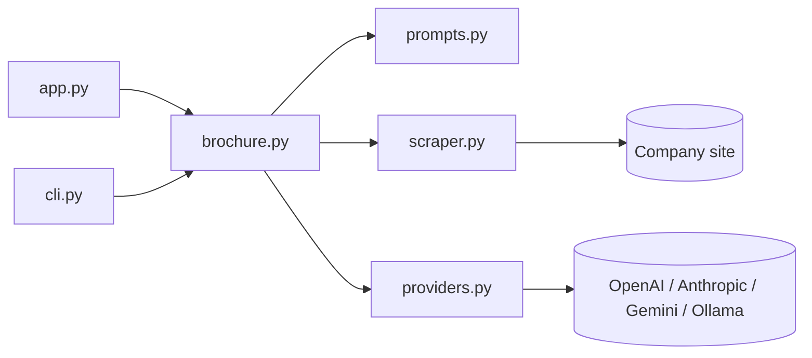
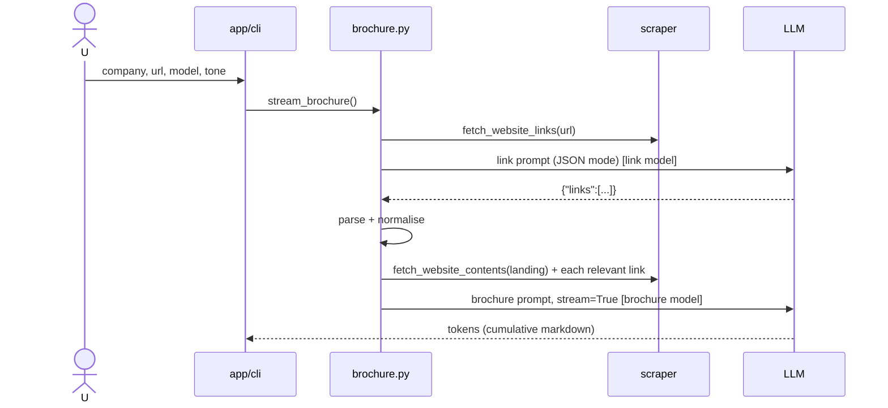

# Company Brochure Generator - Low-Level Design

## 1. Purpose and scope
Produce a short company brochure from a website by chaining two LLM calls: relevance filtering of links (structured JSON output), then synthesis of a brochure from landing + relevant pages, streamed to the user. Adds a model-selectable Gradio UI.
Out of scope: JS rendering, crawling beyond one hop, persistence, PDF export.

## 2. Requirements
- F1 Select relevant links with an LLM and return JSON `{"links": [{"type","url"}]}`.
- F2 Resolve relative links, drop non-http(s)/duplicates.
- F3 Build a brochure from landing page + relevant pages (prompt capped at 5,000 chars).
- F4 Stream output; choose provider (GPT/Claude/Gemini/Ollama) and tone.
- N1 Offline tests; no secrets in code; model names overridable via env.
- N2 One dead sub-page must not abort the run.

## 3. Components
| Module | Responsibility |
|---|---|
| `scraper.py` | `fetch_website_contents`, `fetch_website_links`, `ScrapeError` |
| `providers.py` | `Provider` registry, key/base-URL/model resolution, `make_client` |
| `prompts.py` | system/user prompts, tone map |
| `brochure.py` | pipeline: `select_relevant_links`, `fetch_page_and_all_relevant_links`, `build_brochure_prompt`, `stream_brochure`, `create_brochure` |
| `app.py` / `cli.py` | Gradio streaming UI / argparse CLI |



## 4. Signatures and data models
```python
@dataclass(frozen=True) class Provider: name, base_url, key_env, model_env, default_model, link_model_env, default_link_model, json_mode
def parse_links_json(text) -> {"links": [{"type": str, "url": str}]}
def normalise_links(base_url, links) -> list[dict]
def select_relevant_links(url, provider, client) -> dict
def fetch_page_and_all_relevant_links(url, provider, client) -> str
def stream_brochure(company_name, url, model="GPT", tone="professional", client=None, max_chars=5000) -> Iterator[str]
def create_brochure(...) -> str
```
Streaming yields the *cumulative* text, which is what Gradio's Markdown output expects.

## 5. Main flow


## 6. Prompts and rationale
- **Link system prompt**: one-shot example of the desired JSON shape - cheaper and more reliable than describing a schema; asks the model to turn relative links into absolute (we also enforce this in code since not all models comply).
- **Link user prompt**: raw list of hrefs; excludes ToS/privacy/mailto to keep context small.
- **Brochure system prompt**: audience (customers, investors, recruits), markdown without code fences, include culture/customers/careers when available. Humorous variant swaps in "humorous, entertaining, witty".
- **Brochure user prompt**: company name + concatenated page texts, truncated to 5,000 chars to bound cost.
LLMs are well suited for the link step because "which links matter" needs semantic judgement that is brittle to hand-code.

## 7. Error handling
- Link JSON: native JSON mode where supported (`json_mode`), else regex extraction of the first `{...}`; failure -> `ValueError` surfaced to user.
- Per-page fetch failures are inlined as "(could not be fetched)".
- Missing key -> `RuntimeError` naming the env var. Unknown model/tone -> `ValueError`.
- UI catches everything and prints into the output pane; CLI returns exit code 1.

## 8. Configuration
Env: `OPENAI_API_KEY`, `ANTHROPIC_API_KEY`, `GOOGLE_API_KEY`, `OLLAMA_BASE_URL`, `<PROVIDER>_MODEL`, `<PROVIDER>_LINK_MODEL`. `.env` loaded with `override=True` at client creation.

## 9. External dependencies
openai SDK (all providers; Anthropic and Gemini via their OpenAI-compatible endpoints), requests, beautifulsoup4, gradio, python-dotenv.

## 10. Extensibility
Add a provider = one entry in `PROVIDERS`. Add a tone = one entry in `prompts.TONES`. Swap scraper for Playwright by keeping the two function signatures. Recursively following links is a natural next step (full agent loop).

## 11. Limitations and cost
- Up to N+2 HTTP requests and 2 LLM calls per brochure; cost small (<~6k input tokens total with the cap).
- Anthropic's compat endpoint ignores `response_format`; relies on prompt + tolerant parser.
- Gemini/Claude model ids drift over time - override via env.
- Hard truncation may drop later pages.

## 12. Prerequisites: how the models are trained
Uses hosted pre-trained chat models only. For how such models are fine-tuned, see the sibling fine-tuning projects.
