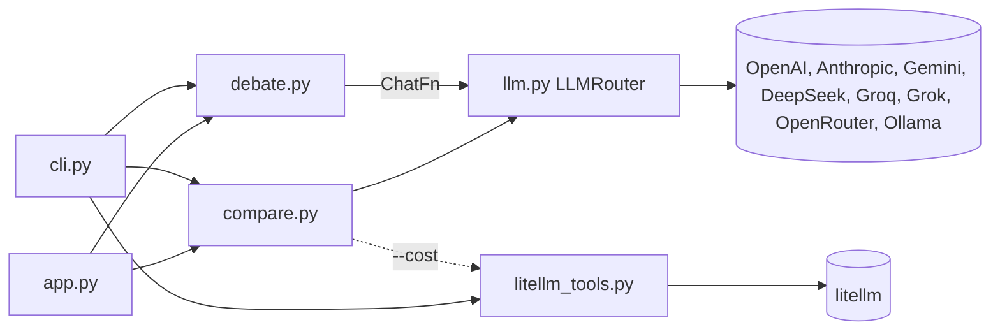
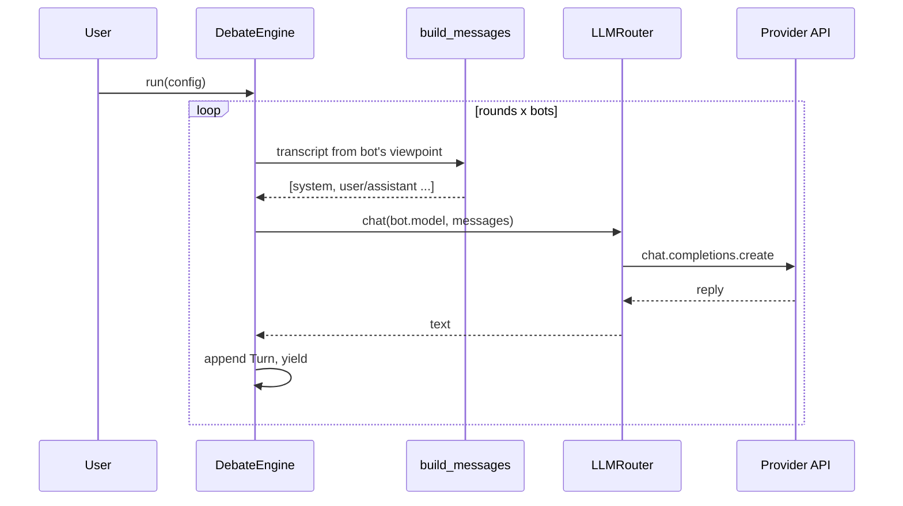
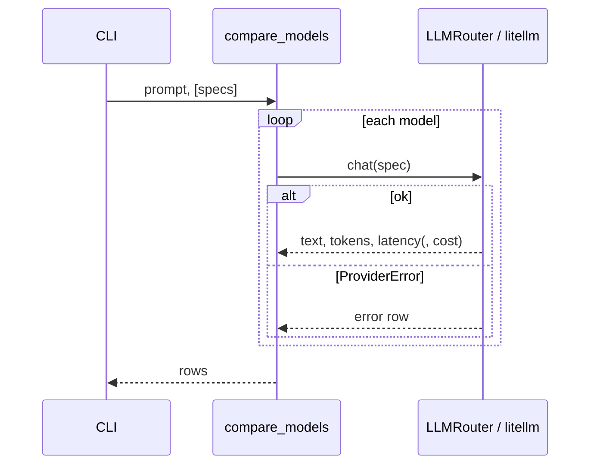

# LLM Debate Arena - Low-Level Design

## 1. Purpose and scope
Show how one client library (the OpenAI SDK) can drive many providers via OpenAI-compatible endpoints, how to compare model answers/cost, how prompt caching reduces cost, and how to orchestrate multi-LLM conversations by projecting a shared transcript into per-bot message lists.
Out of scope: streaming tokens inside a debate turn, tool use, persistent logging, native provider SDK features beyond the compat layer.

## 2. Requirements
- F1 `provider:model` addressing for 8 providers incl. Ollama.
- F2 N-bot conversation (N>=2), configurable system prompts, models, rounds, seed turns, optional topic; presets incl. the classic GPT-vs-Claude.
- F3 Model comparison with graceful per-model failure, optional `reasoning_effort`, optional cost via litellm.
- F4 Prompt-caching demo using Hamlet.
- F5 CLI + Gradio.
- N1 Offline tests; keys only from env; engine independent of any SDK (injected `ChatFn`).

## 3. Components
| Module | Responsibility |
|---|---|
| `llm.py` | `PROVIDERS`, `parse_model`, `LLMRouter` (client cache, `chat`, `text`), `Completion`, `ProviderError` |
| `debate.py` | `Bot`, `Turn`, `DebateConfig`, `build_messages`, `DebateEngine`, JSON config IO |
| `presets.py` | `classic`, `local`, `roundtable` |
| `compare.py` | `PROMPTS`, `compare_models`, `ComparisonRow`, `format_rows` |
| `litellm_tools.py` | `to_litellm_name`, `complete_with_cost`, `cache_demo`, `load_hamlet` (optional dep) |
| `cli.py`, `app.py` | front-ends |
| `data/hamlet.txt` | ~190KB text for the caching demo (bundled sample text) |



## 4. Signatures and data models
```python
ChatFn = Callable[[str, list[dict]], str]
@dataclass Bot(name, model, system_prompt)       @dataclass Turn(speaker, content)
@dataclass DebateConfig(bots, rounds=5, seed=[], topic=None)
def build_messages(bot, transcript, multi_party) -> list[dict]
class DebateEngine: __init__(config, chat); run() -> Iterator[Turn]; seed_turns() -> list[Turn]
def parse_model(spec) -> (provider, model)
class LLMRouter: client(provider) -> OpenAI; chat(spec, messages, **kw) -> Completion; text(spec, messages) -> str
def compare_models(prompt, specs, router=None, reasoning_effort=None, with_cost=False) -> list[ComparisonRow]
def cache_demo(model, completion_fn=None) -> list[dict]
```
JSON config mirrors `DebateConfig` (`config_from_dict` / `config_to_dict`).

## 5. Main flows


Caching demo: (1) question alone, (2) question + full Hamlet, (3) same again; step 3 should report `cached_tokens > 0` and lower cost on providers with implicit prefix caching (Gemini 2.5+/3, OpenAI >=1024 tokens). The shared prefix must come first and be identical, hence the context is appended after the question text deterministically.

## 6. Prompts and why
- Argumentative system prompt vs polite system prompt  create a stable, entertaining contrast: one bot escalates, the other de-escalates, which makes behavioural differences between models visible.
- Roundtable personas (skeptic/optimist/argumentative) add a third viewpoint; replies are capped to "under 3 sentences" in the system prompt to keep context small.
- Moderator topic turn: "The topic of discussion is: X", injected as a user message, so bots all react to the same opener.
- Puzzles (coin, Pushkin worm, dilemma) in `compare.PROMPTS` probe reasoning vs non-reasoning models and behaviour differences.

## 7. Transcript projection (key design point)
One shared list of `Turn`s is the source of truth. For bot B each turn becomes `assistant` if spoken by B else `user`. With more than two bots, other speakers' lines are prefixed with `Name:` so B can tell them apart. Consecutive same-role messages are merged (OpenAI accepts them, Anthropic does not) and a leading user "Hello" is inserted if the first message would be `assistant` (the classic seed starts with GPT's "Hi there").

## 8. Error handling
- `ProviderError` for unknown provider, missing key, API failure (wrapped with spec).
- `compare` records per-model errors and continues; CLI exit code 1 only if all fail.
- `run`: errors abort the conversation; the Gradio runner appends "Stopped: ..." keeping the transcript.
- Config validation: >=2 bots, unique names, no bot called "Moderator", rounds>=1.
- litellm missing -> `ImportError` with install hint.

## 9. Configuration
Env keys per provider (see `.env.example`); `OLLAMA_BASE_URL`. No other global state; models are in the config/specs, not code.

## 10. External dependencies
openai, python-dotenv, gradio; optional litellm (cost + `response._hidden_params["response_cost"]`).

## 11. Extensibility
New provider = one `ProviderInfo` entry. New front-end = inject a different `ChatFn`. Possible additions: judge/moderator bot, token streaming, stop conditions, transcript export, native SDK adapters (Anthropic `cache_control`, google-genai).

## 12. Limitations and cost notes
- Conversation cost grows quadratically with rounds (whole history resent each turn).
- Compat endpoints expose only a subset of provider features (Anthropic's endpoint is documented as for testing; no prompt-cache control there).
- Model ids/prices change; defaults may need updating.
- Cache-demo costs: ~3 large prompts; implicit caching is not guaranteed.

## 13. Prerequisites: how the models are trained
This project only calls hosted/local pre-trained chat models. Background on how such models are produced (pre-training, instruction tuning, fine-tuning) belongs to the sibling fine-tuning projects; this project does not train anything.
