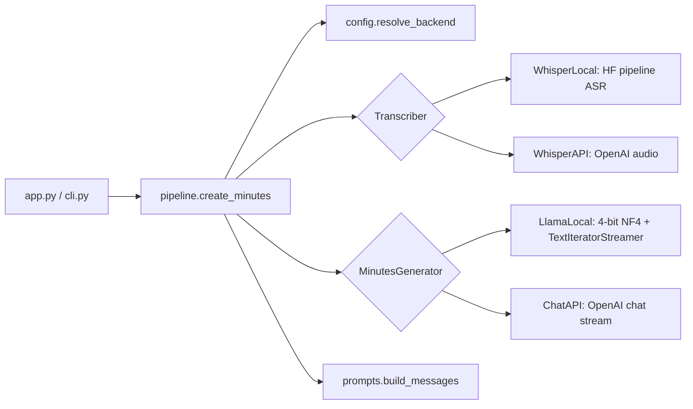
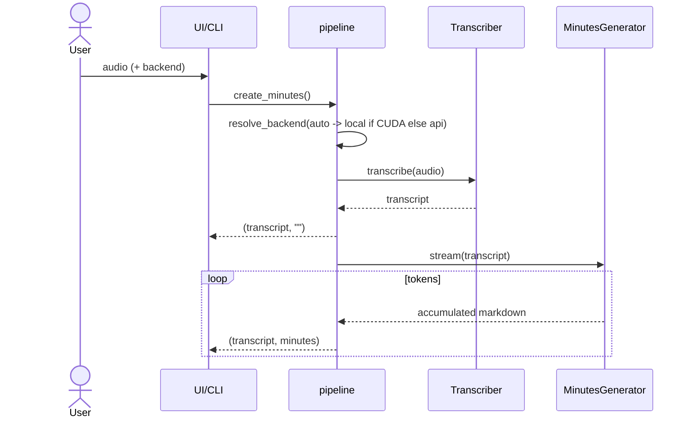

# meeting-minutes-creator: Low-Level Design

## 1. Purpose and scope
Convert a meeting recording into markdown minutes using open-source models (Whisper, Llama 3.1 8B 4-bit) on a GPU,
with an API-based fallback for machines without a GPU. Scope: one audio file per run, English-centric, minutes
generated in a single LLM call, streamed to UI/CLI. Out of scope: diarisation, very long audio chunking, persistence.

## 2. Requirements
- F1 Transcribe audio (local Whisper or API). F2 Generate minutes (attendees, summary, key points, takeaways, action
  items with owners) in markdown. F3 Stream output. F4 Gradio UI + CLI. F5 Accept transcript text directly.
- F6 Auto-select backend by hardware. N1 No secrets in code. N2 Tests offline without GPU/torch. N3 Heavy imports lazy.

## 3. Components
| Module | Responsibility |
|---|---|
| `config.py` | `Settings` (env), `cuda_available()`, `resolve_backend()` |
| `prompts.py` | `SYSTEM_MESSAGE`, `user_prompt`, `build_messages` |
| `transcribe.py` | `Transcriber` protocol, `WhisperLocal`, `WhisperAPI` |
| `minutes.py` | `MinutesGenerator` protocol, `LlamaLocal`, `ChatAPI` |
| `pipeline.py` | `create_minutes` generator, cached factories |
| `app.py` / `cli.py` | front ends |
| `visualizer.py` | token-prediction graph (optional extra) |



## 4. Signatures and data
```python
class Transcriber(Protocol): def transcribe(self, audio_path: str) -> str
class MinutesGenerator(Protocol): def stream(self, transcript: str, meeting_description: str) -> Iterator[str]  # accumulated text
def create_minutes(audio_path=None, transcript=None, backend=None, meeting_description=..., transcriber=None, generator=None) -> Iterator[tuple[str, str]]
def resolve_backend(requested: str, cuda: bool | None = None) -> Literal["local", "api"]
def build_messages(transcription: str, meeting_description: str) -> list[dict]
```
Data: audio path (str) -> transcript (str) -> minutes (markdown str). Messages are OpenAI-style role/content dicts
(also the input format of `apply_chat_template`).

## 5. Main flow

Local generator: model loaded lazily on first call; `generate` runs on a worker thread feeding a
`TextIteratorStreamer` that the main thread iterates.

## 6. Prompts
- System: "You produce minutes of meetings from transcripts, with summary, key discussion points, takeaways and action
  items with owners, in markdown." Fixes role, sections and output format.
- User: introduces the transcript as an *extract* of a meeting (parameterised description; default Denver City
  council), repeats the required sections including attendees "if present" (so the model does not
  hallucinate attendees) and appends the transcript.
Why: a small instruct model follows an explicit section list reliably; markdown output renders directly in Gradio.

## 7. Error handling
- Missing audio -> `FileNotFoundError`; > 25 MB for the API -> `ValueError` with remedy.
- No CUDA when `LlamaLocal` needed -> `RuntimeError` pointing to the API backend.
- Missing `[local]` extra -> `RuntimeError` with install hint. Missing keys -> OpenAI SDK error shown in UI as `Error: ...`.
- UI wraps the pipeline in try/except and renders the message instead of crashing.

## 8. Configuration
`OPENAI_API_KEY`, `HF_TOKEN`, `WHISPER_MODEL` (openai/whisper-medium), `LLAMA_MODEL` (meta-llama/Meta-Llama-3.1-8B-Instruct),
`MAX_NEW_TOKENS` (2000), `OPENAI_TRANSCRIBE_MODEL` (whisper-1), `OPENAI_CHAT_MODEL` (gpt-4.1-mini), `BACKEND` (auto).

## 9. External dependencies
Base: `openai`, `python-dotenv`, `gradio`. Local: `torch`, `transformers>=4.56`, `accelerate`, `bitsandbytes`,
ffmpeg binary. Viz: `networkx`, `matplotlib`.

## 10. Prerequisites: how the models are trained
Whisper (encoder-decoder transformer trained on ~680k hours of weakly supervised multilingual audio) and Llama 3.1
(decoder-only, pre-trained on trillions of tokens then instruction-tuned with SFT/RLHF-style methods) are used as-is
here; this project does no training and has no dependency on any other project. (Optional reading: for fine-tuning
a model on your own data, see the sibling training projects `price-predictor-openai-finetune` and
`price-predictor-qlora-training` in this repo's parent directory.)

## 11. Extensibility
New backend: implement the protocol and register in `pipeline.make_*`. Add diarisation by changing the Whisper
output to speaker-labelled text before `build_messages`. Long audio: split transcript into chunks, map-reduce summaries.

## 12. Limitations and cost
- Single-call minutes: transcripts longer than the model context (Llama 3.1 supports 128k but T4 memory limits the
  practical length) will fail or OOM; no chunking yet.
- 4-bit quantisation slightly degrades quality; Llama 8B can miss owners/dates - review output.
- Whisper medium on T4 is roughly real-time or faster; the 8B 4-bit model generates ~10-20 tokens/s on T4.
- API path cost: Whisper ~$0.006/min audio plus a few cents of chat tokens per meeting. Audio is sent to OpenAI;
  use the local backend for sensitive recordings.
- Not verified in this repo's tests: real Whisper/Llama inference (needs GPU/HF token).
