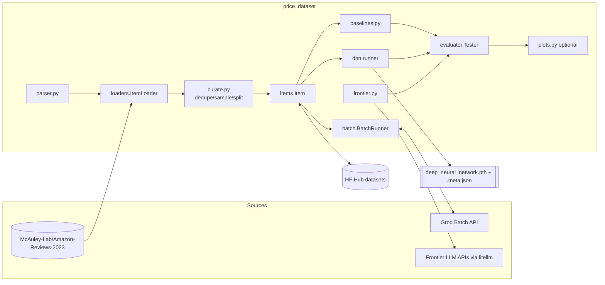
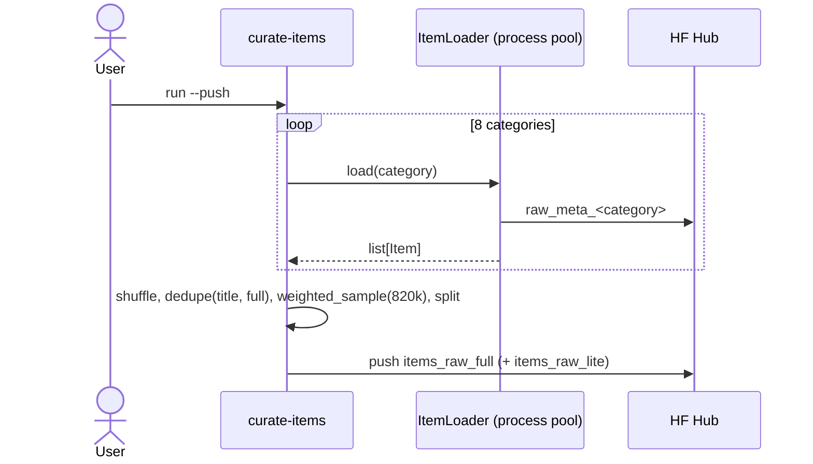
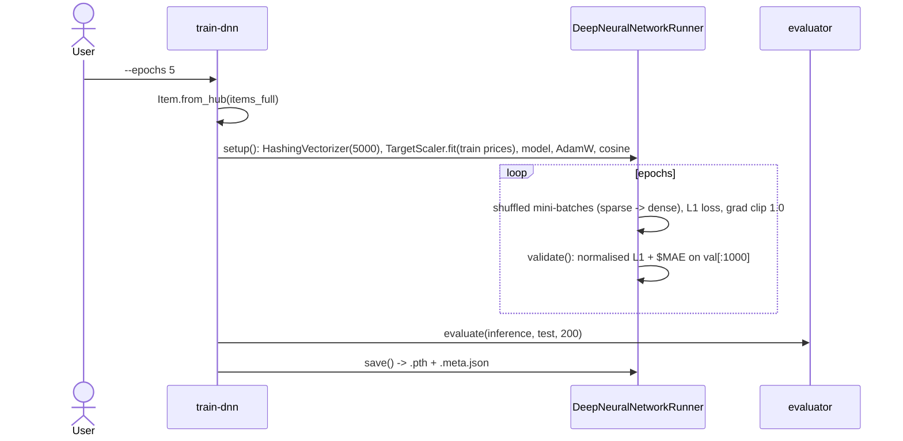

# Low-level design - price-dataset-and-baselines

## 1. Purpose & scope
Create the training/evaluation data for the "Price is Right" capstone, quantify baseline difficulty,
and train the deep neural network (DNN) whose weights can be reused by downstream services. Out of scope: fine-tuning LLMs
(see `price-predictor-openai-finetune`, `price-predictor-qlora-training`) and serving.

## 2. Requirements
| # | Requirement |
|---|---|
| R1 | Build a deduplicated, price-weighted sample (820k) from 8 Amazon-Reviews-2023 categories and publish train/val/test to the Hub. |
| R2 | Rewrite each product into a standard short summary using an LLM, in bulk and cheaply (Groq Batch), resumable. |
| R3 | Provide one evaluation harness (avg error, MSE, RMSLE, r2, hit rate, colours) used by every predictor. |
| R4 | Baselines: random, constant, linear on features, BoW+linear, random forest, XGBoost, human. |
| R5 | Zero-shot frontier LLM predictors through litellm. |
| R6 | `train-dnn` CLI producing `deep_neural_network.pth` + meta sidecar; `eval-dnn`, inference helper. |
| R7 | No import from any external repo, no committed data/weights; offline unit tests. |

## 3. Component diagram


## 4. Modules
| Module | Responsibility |
|---|---|
| `config.py` | `CATEGORIES`, split sizes, `dataset_name(kind, lite)`, `hf_login()`; namespace from `HF_USERNAME`. |
| `items.py` | `Item` (pydantic), `PREFIX`/`QUESTION`, `push_to_hub`, `from_hub` (lazy `datasets` import). |
| `parser.py` | `parse(datapoint, category) -> Item|None`, `scrub`, `simplify`, `get_weight`. |
| `loaders.py` | `ItemLoader.load(workers)`: download one category and parse chunks of 1,000 in a process pool. |
| `curate.py` | `shuffle_and_dedupe`, `sampling_weights`, `weighted_sample`, `split_items`, `lite_subset`, `default_split_sizes`. |
| `preprocessor.py` | Synchronous `Preprocessor.preprocess(text)` via litellm; token/cost tracking; `SYSTEM_PROMPT`. |
| `batch.py` | `make_jsonl_line`, `parse_output_line`, `Batch`, `BatchRunner(create/run/fetch/save/load)`. |
| `evaluator.py` | `post_process`, `color_for`, `compute_metrics -> Metrics`, `Tester`, `evaluate`. |
| `plots.py` | Plotly scatter + running-error charts to HTML (optional). |
| `baselines.py` | Predictor factories + human CSV helpers. |
| `frontier.py` | `make_frontier_pricer(model)`, `FRONTIER_MODELS`. |
| `dnn/targets.py` | `TargetScaler` (log1p + standardise; encode/decode). Pure Python. |
| `dnn/model.py` | `ResidualBlock`, `DeepNeuralNetwork`, `pick_device`. |
| `dnn/runner.py` | `DeepNeuralNetworkRunner` (train/validate/save/inference), `DeepNeuralNetworkPredictor` (inference only). |
| `cli/*` | argparse front-ends: `curate`, `summarize`, `baselines`, `human`, `train_dnn`, `eval_dnn`, `frontier`. |

### Key signatures
```python
class Item(BaseModel):  title:str; category:str; price:float; full:str|None; weight:float|None
                        summary:str|None; prompt:str|None; id:int|None
parse(datapoint: dict, category: str) -> Item | None
weighted_sample(items, size, seed=42) -> list[Item]
BatchRunner(items, folder, client=None, batch_size=1000).create()/run()/fetch()->(done,total)/load()/save()
Tester(predictor, data, title=None, size=200, workers=5, truth_fn=..., title_fn=...).run() -> Metrics
compute_metrics(truths, guesses) -> Metrics(n, average_error, mse, rmsle, r2_percent, hit_rate, green, orange, red)
DeepNeuralNetworkRunner(train, val, num_layers=10, hidden_size=4096, dropout=0.2, lr=1e-3,
                        weight_decay=0.01, batch_size=64, t_max=10, grad_clip=1.0, device="auto")
    .setup(); .train(epochs=5); .save(path, extra_meta) ; .inference(item_or_text) -> float
DeepNeuralNetworkPredictor(weights_path, meta_path=None, device="auto")(item_or_text) -> float
```

## 5. Data models
**Item row on the Hub** (`train` / `validation` / `test`):
`title, category, price(float $0.50-$999.49), full(<=4000 chars; None after summarisation), weight(lb; 0 unknown), summary, prompt, id`.

**Filtering (`parse`)**: price within 0.50-999.49; scrubbed text >= 600 chars; scrub removes
`Part Number, Best Sellers Rank, Batteries Included?/Required?, Item model number` and any >= 7 char
token mixing capitals and digits; description and features truncated to 3000 chars each, total 4000.

**Summary format** (day-2 system prompt):
```
Title: <rewritten short precise title>
Category: <e.g. Electronics>
Brand: <brand>
Description: <1 sentence>
Details: <1 sentence on features>
```

**Prompt format** (used by `Item.make_prompt`; the QLoRA project builds its own):
`"What does this cost to the nearest dollar?\n\n{summary}\n\nPrice is ${round(price)}.00"`.

**Groq batch input line** (`work/<lite|full>/batches/<start>_<end>.jsonl`):
```json
{"custom_id":"123","method":"POST","url":"/v1/chat/completions",
 "body":{"model":"openai/gpt-oss-20b","messages":[{"role":"system","content":"..."},{"role":"user","content":"<item.full>"}],"reasoning_effort":"low"}}
```
Output line: `{"custom_id":"123","response":{"body":{"choices":[{"message":{"content":"Title: ..."}}]}}}`.
State file: `work/<lite|full>/batches_state.json` = list of `{start,end,file_id,batch_id,output_file_id,done}`.

**Human CSV**: `summary,guess` rows (no header), first N test items.

## 6. Sequence diagrams

```mermaid
sequenceDiagram
  actor U as User
  participant S as summarize-items
  participant B as BatchRunner
  participant G as Groq
  participant H as Hub
  U->>S: submit --lite
  S->>H: from_hub(items_raw_lite)
  S->>B: create(); run()
  B->>G: files.create + batches.create (per 1000 items)
  B->>B: save batches_state.json
  U->>S: fetch --wait
  loop until all done
    B->>G: batches.retrieve
    G-->>B: completed + output_file_id
    B->>G: files.content -> output jsonl
    B->>B: apply_output(item.summary)
  end
  U->>S: push
  S->>H: push items_lite (full=None, id=None)
```


## 7. Training pipeline - DNN
| Item | Value |
|---|---|
| Features | `HashingVectorizer(n_features=5000, stop_words="english", binary=True)` over `summary` |
| Target | `y = (log(price+1) - y_mean)/y_std` from train; decode `max(0, exp(y*y_std+y_mean)-1)` |
| Architecture | Linear(5000,4096)+LayerNorm+ReLU+Dropout(0.2) -> 8 x ResidualBlock(2 x [Linear+LayerNorm], ReLU, Dropout 0.2, skip) -> Linear(4096,1); 289,128,449 params |
| Loss / optimiser | L1 (`nn.L1Loss`) on normalised log target; AdamW lr 1e-3, weight_decay 0.01 |
| Schedule | CosineAnnealingLR(T_max=10, eta_min=0), stepped once per epoch (so 5 epochs cover half a cosine) |
| Batch / epochs | 64 / 5 (12,500 steps per epoch on 800k) |
| Regularisation | dropout 0.2, grad-norm clip 1.0 |
| Seeds | numpy/torch/cuda = 42 |
| Validation | first 1,000 val items each epoch; reports normalised L1 and $ MAE |
| Device | cuda > mps > cpu (`--device` overrides) |
| Reference result | val MAE $53.15 after epoch 5; test avg error $46.49 on 200 items |

Baselines: LinearRegression on `[weight, weight_unknown, text_length]`; CountVectorizer(max_features=2000, english stop words)
+ LinearRegression; RandomForestRegressor(100 trees, first 15,000 rows); XGBRegressor(1000 trees, lr 0.1).
Frontier prompt: `"Estimate the price of this product. Respond with the price, no explanation\n\n{summary}"`.

## 8. Metrics
`average_error = mean|guess-truth|`; `mse`; `rmsle = sqrt(mean((log1p(g)-log1p(t))^2))` (guesses clipped at 0);
`r2 = 1 - SSres/SStot`; colour per datapoint (green: err<40 or err/truth<0.2; orange: err<80 or err/truth<0.4; else red);
`hit_rate = greens / n`. `running_mean_ci` yields the cumulative mean +/- 1.96 sd/sqrt(n) used in the trend chart.

## 9. Error handling
* `parse` returns `None` for non-numeric/out-of-range price or short text; weight parse errors -> 0.
* Batch: failed/expired/cancelled -> `RuntimeError`; `run()` skips already-submitted batches; `fetch()` is idempotent and saves state after each batch; `push` refuses while any summary is missing.
* Evaluator: LLM replies are parsed with a regex; unparseable -> 0 (counted as an error, not a crash). Predictor exceptions propagate (fail fast).
* Heavy/optional deps imported lazily with a clear ImportError at the point of use.

## 10. Configuration
Env: `HF_TOKEN`, `HF_USERNAME`, `GROQ_API_KEY`, `PREPROCESSOR_MODEL`, provider keys. CLI flags listed in README.
Constants in `config.py`, `parser.py`, `batch.py`.

## 11. Cost / time
Full curation: hours + tens of GB download. Summaries: < $1 lite, ~ $30 full (Groq gpt-oss-20b batch). RF on 800k: ~15 h.
DNN 5 epochs 800k: ~4 h on M1 (MPS). Frontier eval of 200 items: cents to a few dollars depending on model.

## 12. Limitations
* The Amazon source dataset needs `datasets<4` (loading script). `rampangeni/items_*` avoid this.
* Test-set evaluation uses only the first 200 items by default: standard error is large (see CI chart).
* Hashing bag-of-words ignores word order; a 289M-parameter MLP over-fits (train loss 0.24 vs val 0.39 normalised L1).
* Frontier model ids in `FRONTIER_MODELS` will age; override with `--model`.
* `human_guesses.csv` only reproduces the reference run against `rampangeni/items_full` test[:100].
* Hyper-parameters are fixed reference values; there is no hyper-parameter search.
