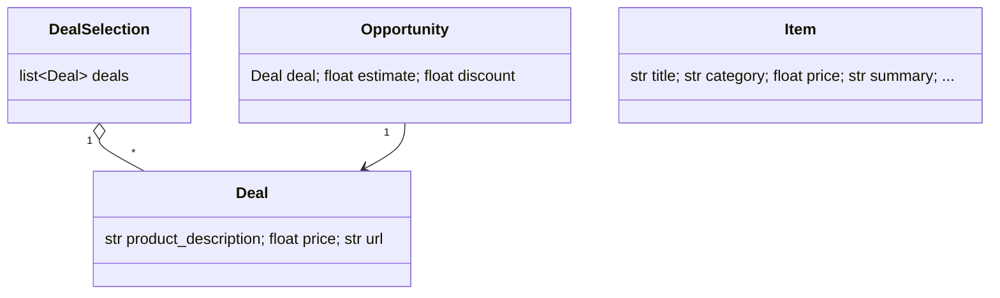
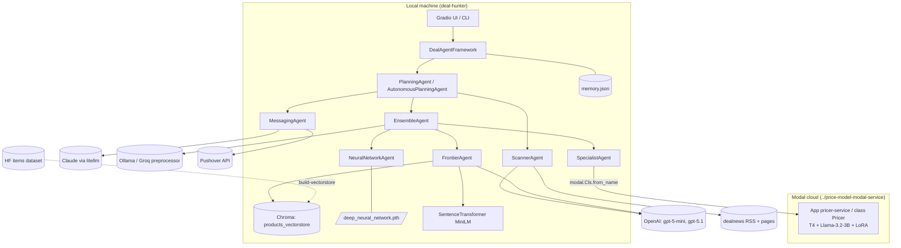
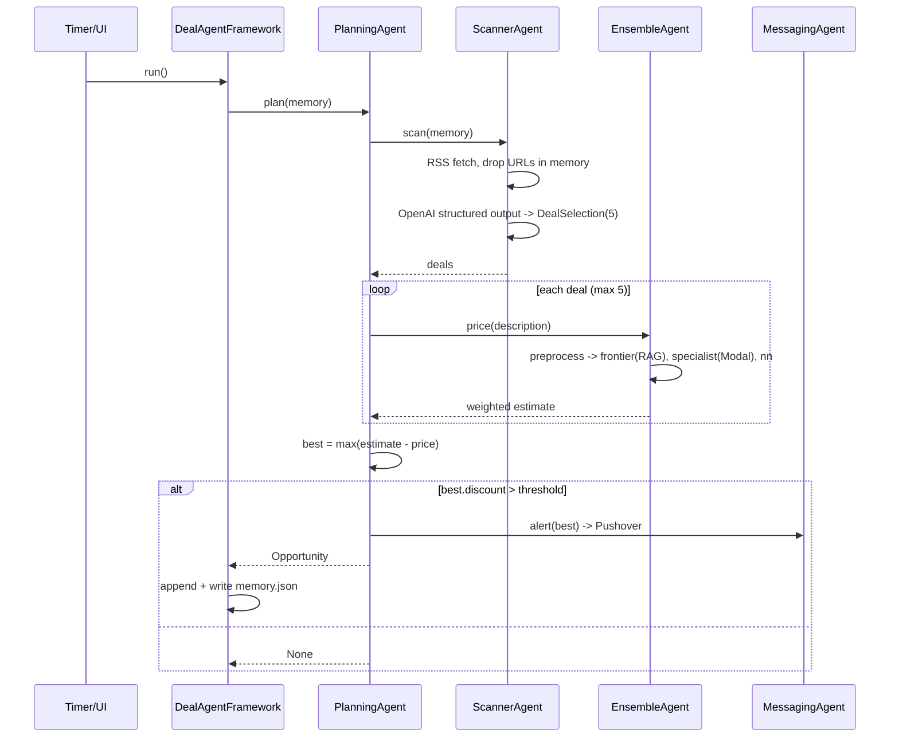
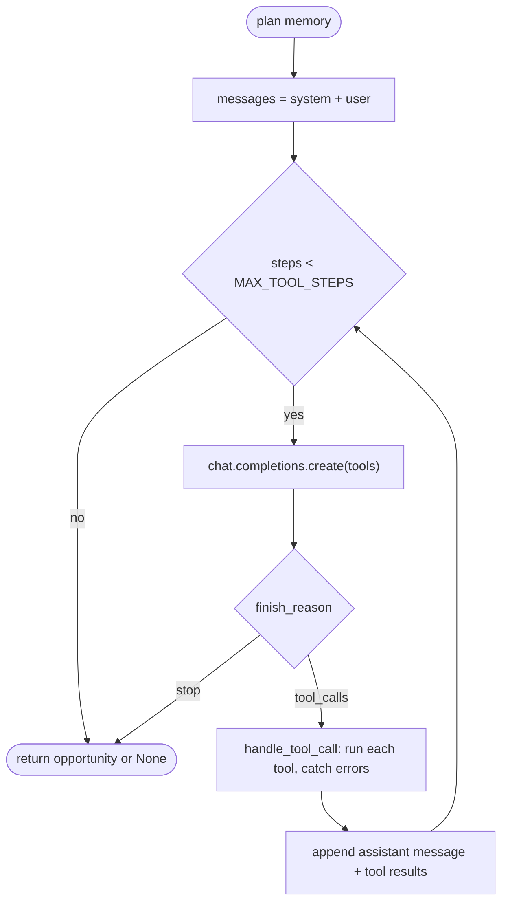

# Low-Level Design: price-is-right-deal-hunter

## 1. Purpose and scope

An agentic application that finds online deals whose advertised price is well below the model-estimated true price and
notifies the user. It demonstrates agent decomposition (specialised agents behind a common interface), RAG, a deployed
fine-tuned model, an ensemble, structured outputs, LLM tool-calling and a live UI.

In scope: scanning, pricing ensemble, planners, notifications, memory, vector-store build, UI, CLI. Out of scope: training the
models (see section 2), deploying the Modal pricer (`../price-model-modal-service`), multi-user hosting, scheduling beyond the
UI timer.

## 2. Prerequisites: how the models are trained

This application is the **use side** of the Price-Is-Right capstone. Three artifacts are trained/built elsewhere (dataset, baselines,
fine-tuning) and consumed here. Sibling projects are referenced by name only; nothing here imports their code.

| Artifact | Training/build project | Consumed by | Config |
|---|---|---|---|
| HF **items dataset** (train split: `summary`, `category`, `price`) | [`../price-dataset-and-baselines`](../price-dataset-and-baselines) | `build-vectorstore` -> Chroma -> **FrontierAgent** RAG | `HF_ITEMS_DATASET` (default `rampangeni/items_full`; `items_lite`) |
| **`deep_neural_network.pth`** (state dict; architecture 5000 -> 4096 x 10 residual layers -> 1; target = `(ln(price+1) - 4.4349) / 1.0329`) | [`../price-dataset-and-baselines`](../price-dataset-and-baselines) | **NeuralNetworkAgent** (`dnn.py`) | `NN_WEIGHTS_PATH` |
| **Fine-tuned LoRA adapter** (Llama 3.2 3B QLoRA, pinned HF commit revision) | [`../price-predictor-qlora-training`](../price-predictor-qlora-training) (comparison: [`../price-predictor-openai-finetune`](../price-predictor-openai-finetune), not consumed) | Served by [`../price-model-modal-service`](../price-model-modal-service) (`ADAPTER_REPO` / `HF_USER`+`RUN_NAME`, `ADAPTER_REVISION`); this app calls the **deployed Modal class by name** via **SpecialistAgent** | `MODAL_APP_NAME`, `MODAL_CLASS_NAME` |

Contract details that must stay in sync with training:
- The specialist and NN were trained on LLM-summarised text (Title/Category/Brand/Description/Details), which is why the
  `Preprocessor` rewrites every description before the ensemble prices it. Frontier retrieval documents are the dataset `summary` field,
  the same shape.
- The embedding model for the vector store (`all-MiniLM-L6-v2`) must be the same at build time and query time.
- The NN's `Y_MEAN/Y_STD` constants and the hashing vectorizer (5000 features, English stop words, binary) are hard-wired in `dnn.py` and must
  match the training notebook.

Fallbacks (the system runs without the training projects wherever feasible):
1. `SPECIALIST_BACKEND=mock` -> `MockPricer` (hash-based stub); or `ENABLE_SPECIALIST=0`.
2. Missing/failed NN weights -> `NeuralNetworkAgent` raises a pointed `FileNotFoundError`; `EnsembleAgent.from_settings` logs it and continues
   without the component. Likewise `ENABLE_NN=0`.
3. No vector store -> `ENABLE_FRONTIER=0` (ensemble uses the remaining components).
4. The pre-built dataset/adapter are the defaults, so no training run is needed to try the system.
5. `deal-hunter ui --demo` / `run-once --demo`: canned deals, mock pricer, no RAG/NN/preprocessor/Pushover, no API keys at all.
Weights of the ensemble are renormalised over the components that are present.

## 3. Requirements

Functional: F1 fetch deals from RSS and scrape detail; F2 select the 5 best-described deals with explicit prices; F3 price a product
via 3 models + combine; F4 compute `discount = estimate - price`; F5 notify when `discount > DEAL_THRESHOLD` (single best deal);
F6 never re-surface a URL (memory); F7 two planning styles (fixed workflow, LLM tool-calling); F8 UI with live logs, table, plot, timer;
F9 build/rebuild the vector store; F10 run each agent alone.
Non-functional: N1 external services injectable and fakeable; N2 degrade rather than crash when a model is unavailable; N3 no secrets in
repo; N4 offline tests; N5 optional heavy deps via extras; N6 logs attributable by agent and colour.

## 4. Modules and responsibilities

| Module | Responsibility |
|---|---|
| `config.py` | `Settings` from env (models, thresholds, weights, flags, paths, feeds); `parse_weights` |
| `models.py` | `Deal`, `DealSelection`, `Opportunity`, `Item` (pydantic) |
| `scraping.py` | `extract`, `ScrapedDeal` (RSS entry + page scrape), `fetch` |
| `preprocessor.py` | litellm rewrite of descriptions |
| `agents/base.py` | `Agent`: colour-tagged `log()` |
| `agents/scanner.py` | `ScannerAgent` (+ `DemoScannerAgent`, canned `SAMPLE_DEALS`) |
| `agents/specialist.py` | `SpecialistAgent`, `ModalPricer` (by name), `MockPricer` |
| `agents/frontier.py` | `FrontierAgent` RAG |
| `dnn.py`, `agents/neural_network.py` | network + inference; agent wrapper |
| `agents/ensemble.py` | `EnsembleAgent` |
| `agents/messaging.py` | `MessagingAgent` (Pushover, LLM text) |
| `agents/planning.py`, `agents/autonomous_planning.py` | the two orchestrators |
| `vectorstore.py` | Chroma open/reset/build, plot data (t-SNE), colours |
| `framework.py` | `DealAgentFramework`, `build_planner`, memory I/O |
| `log_utils.py` | colour codes, `reformat` (ANSI -> HTML), root handler, `QueueHandler` |
| `ui.py`, `ui_helpers.py` | Gradio app; gradio-free streaming/table helpers |
| `cli.py` | `deal-hunter` commands |

## 5. Class and function signatures

```python
class Agent: name: str; color: str; log(message: str) -> None

class ScannerAgent(Agent):
    __init__(settings=None, client=None, fetcher=None)
    fetch_deals(memory: list[Opportunity]) -> list[ScrapedDeal]
    make_user_prompt(scraped) -> str
    scan(memory=()) -> DealSelection | None          # structured output; filters price <= 0
    test_scan(memory=()) -> DealSelection             # canned
class SpecialistAgent(Agent): __init__(settings=None, pricer=None); price(description: str) -> float
class FrontierAgent(Agent):
    __init__(collection, settings=None, client=None, encoder=None)
    find_similars(description) -> (documents: list[str], prices: list[float]); make_context(...); messages_for(...)
    get_price(text: str) -> float (static); price(description) -> float
class NeuralNetworkAgent(Agent): __init__(settings=None, network=None); price(description) -> float
class EnsembleAgent(Agent):
    __init__(components: dict[str, PricerLike], weights=None, strategy="weighted", preprocessor=None)
    from_settings(collection, settings, factories=None) -> EnsembleAgent   # classmethod
    combine(estimates: dict[str, float]) -> float; price(description) -> float
class MessagingAgent(Agent):
    push(text) -> bool; alert(opportunity) -> bool; craft_message(description, deal_price, estimate) -> str; notify(description, deal_price, estimate, url) -> bool
class PlanningAgent(Agent):  __init__(scanner, ensemble, messenger, settings=None); run(deal) -> Opportunity; plan(memory=()) -> Opportunity | None
class AutonomousPlanningAgent(Agent):
    __init__(scanner, ensemble, messenger, settings=None, client=None)
    scan_the_internet_for_bargains() -> str; estimate_true_value(description) -> str
    notify_user_of_deal(description, deal_price, estimated_true_value, url) -> str
    get_tools() -> list[dict]; handle_tool_call(message) -> list[dict]; plan(memory=()) -> Opportunity | None
class DealAgentFramework:
    __init__(settings=None, planner=None, collection=None, demo=False)
    read_memory() / write_memory(); reset_memory(settings) [classmethod]; init_agents_as_needed(); run() -> list[Opportunity]
    get_plot_data(settings, max_datapoints) [classmethod]
build_planner(settings, collection=None, demo=False) -> PlanningAgent | AutonomousPlanningAgent
build_vectorstore(rows, collection, encoder, batch_size=1000, limit=None, progress=False) -> int
```
`PricerLike` is anything with `price(str) -> float`; this is what makes every agent swappable and testable.

## 6. Data models


`Deal` and `DealSelection` double as the OpenAI Structured Outputs schema; their `Field(description=...)` strings are prompt text
(they tell the model to quote the real price for "$100 off" deals). `Opportunity` is persisted to `memory.json` via `model_dump()`.
Chroma record: id `doc_<n>`, document = item `summary`, embedding = MiniLM (384-d), metadata `{category, price}`.

## 7. Component and deployment diagrams





## 8. Agent orchestration and the tool-calling loop

Two orchestrators share the same three capabilities.

**PlanningAgent (deterministic).** Fixed pipeline scan -> price each -> sort by discount -> alert best if above `DEAL_THRESHOLD` (default $50).
Predictable cost and behaviour.

**AutonomousPlanningAgent (LLM-driven).** The planner LLM (`PLANNER_MODEL`, default gpt-5.1) receives a system prompt ("find great deals ... notify the
user of the best bargain"), a user prompt (scan, estimate each, pick the single most compelling, notify once, reply OK) and three function tools:

| Tool | Backed by | Returns |
|---|---|---|
| `scan_the_internet_for_bargains()` | `ScannerAgent.scan(memory)` | `DealSelection` JSON or "No deals found" |
| `estimate_true_value(description)` | `EnsembleAgent.price` | sentence with the estimate |
| `notify_user_of_deal(description, deal_price, estimated_true_value, url)` | `MessagingAgent.notify` | "Notification sent ok" |


Rules: the loop ends when the model stops requesting tools; every tool result is a **string** (errors included, so the model can recover);
unknown tools and malformed JSON arguments yield an error string, not an exception; a second `notify` call is ignored (idempotent: the tool says
"only call this one time", and the code enforces it); the per-run `Opportunity` is reset at the start of `plan`; a `max_tool_steps` cap (default 10)
guards against runaway loops. The messages list is copied per run (the notebook version shared a class-level list).

## 9. Prompts and why

- **Scanner system/user prompts**: pick the 5 *most detailed* descriptions with *clear* prices; rephrase to describe the product, not the deal
  terms; be careful with "$XXX off" (a discount is not a price); drop uncertain ones. Rationale: downstream estimators price *products*, so
  deal language would bias them, and a wrong price creates false "bargains". `reasoning_effort="minimal"` keeps latency/cost low.
- **Frontier prompt**: "Estimate the price ... Respond with the price, no explanation" + 5 retrieved `(summary, price)` pairs. RAG supplies
  nearest-neighbour anchors; terse output makes parsing trivial (`get_price`); `seed=42`, `reasoning_effort=none` for determinism/speed.
- **Preprocessor prompt**: fixed 5-field format matching the training data distribution.
- **Messaging prompt**: 2-3 exciting sentences; the push is truncated to 200 chars + URL (Pushover limit friendly).
- **Planner prompts**: explicit order of operations and a single notification.

## 10. Ensemble design

`combined = sum(w_i * p_i) / sum(w_i over available i)`, default weights 0.8 frontier / 0.1 specialist / 0.1 NN (the hand-tuned blend where the
RAG frontier model is clearly strongest). Failure of a component (exception) removes it for that call and renormalises. `ENSEMBLE_STRATEGY=min` returns
the minimum (conservative, fewer false bargains) - an extension, not in the source. If survivors have no configured weight, the plain mean is used. If every
component fails the call raises `RuntimeError`, which `PlanningAgent.plan` propagates (the UI shows "Run failed").

## 11. Error handling and retries

| Failure | Behaviour |
|---|---|
| Feed/entry scrape error | log + skip that entry/feed (`ScrapedDeal.fetch`); request timeout 15 s |
| Scanner LLM returns nothing parsable | `scan` returns None -> planner returns None |
| One ensemble component fails/unavailable | dropped, weights renormalised; init-time failures logged by `from_settings` |
| Pushover down / bad status / no credentials | `push` returns False, never raises; dry-run log when unconfigured |
| Message crafting LLM fails | plain-template fallback text |
| Tool failure in autonomous loop | error string returned to the model |
| Runaway tool loop | `max_tool_steps` cap |
| Vector store empty/missing | UI plot shows a message instead of crashing; Frontier needs it and is skipped when `collection is None` |
| Modal unavailable | SpecialistAgent raises at init (-> skipped by ensemble) or per call (-> dropped for that call) |
Retries: no blind retries inside agents (cost, duplicate side effects). The Modal-side client retry lives in `../price-model-modal-service`.
The UI timer is the outer retry: the next tick re-runs the pipeline.

## 12. Logging

`Agent.log` emits `logging.info(BG_BLACK + <colour> + "[Agent Name] msg" + RESET)`; one colour per agent (Scanner cyan, Specialist red, Frontier blue,
NN magenta, Ensemble yellow, Planner green, Messaging white, Framework blue-bg/white-fg). The terminal shows ANSI. For the UI, `ui.run_with_logging`
attaches a `QueueHandler` to the root logger for the duration of a run (and detaches it afterwards, fixing the handler leak in the notebook version),
the worker thread runs the planner while the generator `stream_run` drains the queue, converts ANSI to `<span style="color:...">` with
`log_utils.reformat`, and yields `(log_data, html, table)` so Gradio streams the last 18 lines into a scrolling div. `init_logging` is idempotent.

## 13. Configuration

All env-driven through `Settings.from_env` (`.env.example` lists everything): model names per agent, `PLANNER`, `DEAL_THRESHOLD`, `ENSEMBLE_*`,
`ENABLE_*` flags, `DEAL_FEEDS`, Modal names, Pushover keys, paths (`CHROMA_PATH`, `MEMORY_PATH`, `NN_WEIGHTS_PATH`), `HF_ITEMS_DATASET`, UI refresh and plot points.
Dependencies are injected into every agent constructor, so tests and alternative backends need no monkeypatching of globals.

## 14. Cost notes

Per run: 1 scanner call (long prompt: ~30 scraped deals, a mini model), then per deal (<=5): 1 frontier call, 1 Modal call, 1 preprocessor call, NN local;
plus 1 messaging call if notified. The autonomous planner adds a few planner turns with the full deal JSON in context. The UI timer re-runs every 5 minutes, so a
long-running UI accrues cost continuously - raise `UI_REFRESH_SECONDS`. Modal: scale-to-zero by default; warm containers bill continuously
(see `../price-model-modal-service`). The vector store build is local compute (30+ min for 800k items on a GPU). Memory prevents re-pricing seen deals.

## 15. Extensibility

New feed sources: `DEAL_FEEDS` or a new scraper producing objects with `url` and `describe()`. New pricer: any class with `price(str)->float`
added to the `components` dict (and a weight). New notifier: replace `MessagingAgent` (needs `alert`, `notify`). Swap models by env. A learned blender
(linear regression on held-out predictions) could replace fixed weights. The autonomous tool set can be extended (e.g. a web-search tool or an MCP server).

## 16. Limitations

Scraping is tied to dealnews' HTML (`content-section`, `snippet summary`). Prices are scraped/LLM-extracted and can be wrong; estimates have the
error profile of the training data (Amazon-era product mix), so new products or other currencies are poorly covered. Single-process, single-user; memory is a flat JSON
file (not concurrent-safe). The UI runs agents in a thread and does not cancel in-flight runs. Notebook behaviours that were kept: the 5-deal cap and the single
best deal alert. Model IDs (`gpt-5.1`, `gpt-5-mini`, `claude-sonnet-4-5`) and `reasoning_effort` support are the defaults; change them via env if unavailable.
Live-service behaviour (OpenAI, Modal, Pushover, RSS) is not covered by the automated tests.
