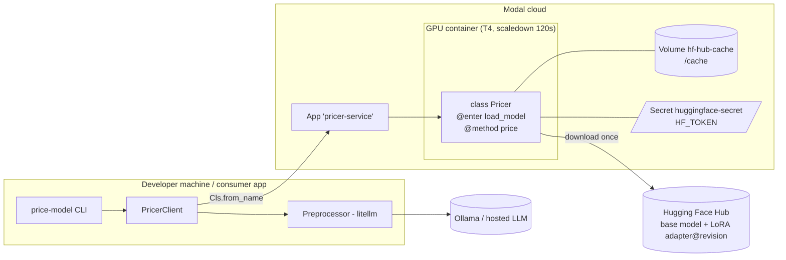
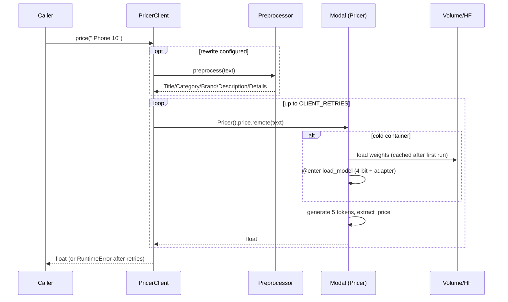

# Low-Level Design: price-model-modal-service

## 1. Purpose and scope

Expose the fine-tuned Llama 3.2 3B QLoRA price predictor as an on-demand, pay-per-use GPU service on Modal and give
Python callers a small, name-based client.

In scope: Modal app definitions (ephemeral and deployed), model loading/inference, config, client, retry, optional
text rewrite, CLI. Out of scope: training (see Prerequisites), the agent system that consumes the price
(`../price-is-right-deal-hunter`), REST endpoints / auth in front of Modal, batching.

## 2. Prerequisites: how the models are trained

The service is a pure consumer of artifacts produced elsewhere.

- **[`../price-predictor-qlora-training`](../price-predictor-qlora-training)** fine-tunes `meta-llama/Llama-3.2-3B` with QLoRA
  on the price-prediction prompt and pushes the **LoRA adapter** to the HF Hub as `{HF_USER}/{PROJECT_NAME}-{RUN_NAME}`
  (e.g. `rampangeni/price-2025-11-28_18.47.07`). The commit hash of that repo is the **revision** pinned here.
- **[`../price-dataset-and-baselines`](../price-dataset-and-baselines)** builds the items dataset and baselines; not
  consumed by this project.

| Artifact consumed | Config / env var | Default |
|---|---|---|
| Base model (gated) | `BASE_MODEL` | `meta-llama/Llama-3.2-3B` |
| Adapter repo | `ADAPTER_REPO`, else `HF_USER` + `PROJECT_NAME` + `RUN_NAME` | `rampangeni/price-2025-11-28_18.47.07` |
| Adapter revision (commit) | `ADAPTER_REVISION` | `3e6de2528c7987fd54ac0c47094066f293655dc4` |
| HF credentials | Modal Secret `HF_SECRET_NAME` with key `HF_TOKEN` | `huggingface-secret` |

Pinning the revision makes deployments reproducible: re-training and pushing a new adapter never silently changes
the service. To use your own run, set the three variables and redeploy.

Fallbacks without any training run of your own: (a) default points at a pre-built private adapter (the Modal HF secret needs read access); (b) `BASE_ONLY=1`
serves the bare base model (`ServiceSettings.finetuned_model == ""`, adapter step skipped); (c) client backend `mock`
(`MockPricer`) needs neither Modal nor a GPU. The training/serving contract that must not drift is the prompt in
`prompts.py` (`QUESTION` + description + `Price is $`).

## 3. Requirements

Functional: F1 price a description -> float dollars; F2 deploy as a named Modal app; F3 callers resolve it by name;
F4 optional description rewrite; F5 keep-warm control at runtime; F6 runnable teaching-app ladder (hello, llama, ephemeral).
Non-functional: N1 scale to zero by default; N2 warm latency ~2 s, cold ~30 s once weights cached; N3 offline unit tests;
N4 no secrets in code; N5 client must not import the service module (so consumers need only names).

## 4. Modules and responsibilities

| Module | Responsibility | Heavy deps |
|---|---|---|
| `config.py` | `ServiceSettings` from env; derived adapter id; `container_env()` | none |
| `prompts.py` | `build_prompt`, `extract_price`; training-compatible format | none |
| `_inference.py` | `load_model` (4-bit + adapter), `generate_price`; runs in container | torch, transformers, peft (lazy) |
| `service.py` | Modal app, image, secret, volume, `Pricer` class (`@enter` + `@method`) | modal |
| `service_function.py` | Function variant, reloads model every call | modal |
| `apps/hello.py`, `apps/llama_smoke.py`, `apps/pricer_ephemeral.py` | teaching-app ladder | modal |
| `client.py` | backends, `PricerClient` (retry, rewrite, autoscaler) | modal (lazy) |
| `preprocessor.py` | litellm rewrite, token/cost accounting | litellm (lazy) |
| `cli.py` | argparse commands | - |

## 5. Signatures

```python
@dataclass(frozen=True) class ServiceSettings:
    app_name, class_name, function_name, hf_secret_name, base_model, hf_user, project_name, run_name,
    revision, adapter_repo, base_only, gpu, timeout, min_containers, scaledown_window, cache_volume, cache_dir,
    backend, retries
    finetuned_model -> str; adapter_revision -> str | None
    from_env(env=None) -> ServiceSettings; container_env() -> dict[str, str]

build_prompt(description: str) -> str
extract_price(text: str) -> float                   # 0.0 when no number

load_model(settings) -> (tokenizer, model); generate_price(tokenizer, model, description, max_new_tokens=5) -> float

class Pricer:  setup() [@enter]; price(description: str) -> float [@method]
price(description: str) -> float                      # function variant

class PricerBackend(Protocol): price(description) -> float
MockPricer | ModalClassPricer(settings) | ModalFunctionPricer(settings)
make_backend(name, settings) -> PricerBackend
class PricerClient(backend=None, settings=None, preprocessor=None, retries=None, sleep=time.sleep):
    price(description) -> float; price_many(list) -> list[float]; keep_warm(minutes=20); cool_down()
class Preprocessor(model_name=None, reasoning_effort=None, base_url=None): preprocess(text) -> str; total_cost, total_*_tokens
```

## 6. Data model

There is no persistent state. The wire contract is `str -> float`. The model's textual contract is
`"What does this cost to the nearest dollar?\n\n{description}\n\nPrice is $"` -> continuation such as `129.00`.
Item/Deal/Opportunity models live in the consumer project; this service deliberately knows only strings.

## 7. Deployment and component diagrams





## 8. Deployment lifecycle: ephemeral -> deployed

1. **Ephemeral** (`with app.run():`): the app exists for the duration of the block; used by `run-ephemeral` and the teaching apps.
   Each call re-creates a container and re-loads the model (minutes).
2. **Deployed function** (`service_function`): persistent name, still reloads the model per call.
3. **Deployed class** (`service`): `@modal.enter()` loads once per container; the container lives for
   `scaledown_window` seconds after the last request; `min_containers=1` keeps one alive permanently.
   HF cache is a Volume (`HF_HUB_CACHE=/cache`) so a cold start skips the download.
   `update_autoscaler(scaledown_window=1200)` changes the idle window at runtime without redeploying.

Config reaches the container through `Image.env(settings.container_env())` because `.env` is not shipped; package code
is shipped via `Image.add_local_python_source("price_model_service")` (Modal no longer auto-mounts local modules).

## 9. Prompt and decoding design

- Training-matched prompt; greedy decoding, `max_new_tokens=5` (a price rarely needs more), `set_seed(42)` for reproducibility.
- Only the **new** tokens are decoded and parsed (splitting the whole decoded text on `Price is $`, which breaks
  if the description contains that string); `extract_price` still tolerates a full decode by using the last prefix.
- 4-bit NF4 + double quantisation + fp16 compute fits a 3B model on a 16 GB T4 comfortably.
- Preprocessor prompt asks for a fixed 5-field format because the model was trained on LLM-summarised items.

## 10. Error handling and retries

- `PricerClient.price`: up to `CLIENT_RETRIES` attempts with exponential backoff (1 s, 2 s, ...), then `RuntimeError`
  chaining the last cause. Covers cold-start timeouts and transient Modal errors.
- Unparseable model output -> `0.0` (documented; callers such as the ensemble should treat 0 as "no signal").
- Modal-side timeout `TIMEOUT_SECONDS` (default 1800) bounds a request including a cold load.
- Autoscaler calls on a non-class backend raise a clear `RuntimeError`.
- Preprocessor failures propagate (no silent fallback) so a missing Ollama is visible.

## 11. Logging

Python `logging`: client warnings per failed attempt; CLI configures `basicConfig(INFO)`. Container logs are visible in
the Modal dashboard / `modal app logs pricer-service`; `modal.enable_output()` streams build/run logs for ephemeral runs.
(The colour-coded agent logs to a UI belong to the consumer project.)

## 12. Configuration

All via env / `.env` (see `.env.example`): app/class/function names, secret name, base model, adapter id+revision,
`BASE_ONLY`, `GPU`, `TIMEOUT_SECONDS`, `MIN_CONTAINERS`, `SCALEDOWN_WINDOW_SECONDS`, `HF_CACHE_VOLUME`,
`PRICER_BACKEND`, `CLIENT_RETRIES`, `PRICER_PREPROCESSOR_MODEL`. Settings are read at import time of the app module, i.e.
at `modal deploy` time on the developer machine; redeploy after changing them.

## 13. Cost notes

T4 is billed per second while a container is up. Scale-to-zero costs nothing idle; each cold start pays load time
(~30 s with cached weights). `MIN_CONTAINERS=1` bills 24/7. `warm` extends the idle window only. Image builds and the
first weight download are one-offs. The preprocessor is free with local Ollama, otherwise a small per-call LLM cost
(tracked in `Preprocessor.total_cost`).

## 14. Extensibility

- Add a web endpoint (`@modal.fastapi_endpoint`) next to `price` for non-Python callers.
- Batch method (`price_many` server side) and `@modal.concurrent` to raise throughput.
- Other GPUs (`GPU=L4/A10G`) or other adapters by env only.
- A new backend only has to implement `PricerBackend.price`.

## 15. Limitations

Single-item calls; no auth beyond Modal's; first deploy is slow; output precision is to the dollar; gated base model
requires licence acceptance; `service` and `service_function` share an app name so only one is live; Modal API
details (`scaledown_window`, `min_containers`) follow modal>=1.1 and may change; deployment itself is not covered by tests.
