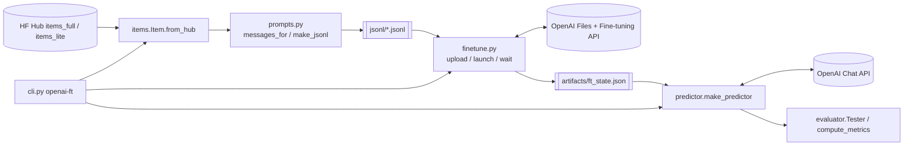
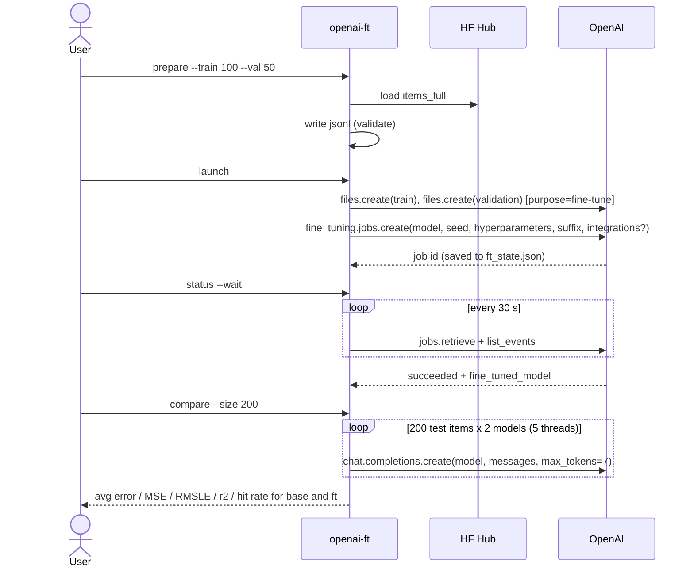

# Low-level design - price-predictor-openai-finetune

## 1. Purpose & scope
Fine-tune a hosted frontier model (`gpt-4.1-nano`) with the OpenAI fine-tuning API to predict prices from product
summaries, monitor the job, and evaluate it against the base model using the shared metrics.
Out of scope: dataset creation / baselines (`price-dataset-and-baselines`), open-source fine-tuning (`price-predictor-qlora-training`).

## 2. Requirements
| # | Requirement |
|---|---|
| R1 | Read `<HF_USERNAME>/items_{full,lite}` and write chat-format JSONL (train + validation). |
| R2 | Upload files, create a job with seed/epochs/batch size/suffix, optional W&B integration. |
| R3 | Monitor a job to completion and persist the resulting model name. |
| R4 | Evaluate any model (`ft`, `base`, arbitrary id) and compare, with avg error / MSE / RMSLE / r2 / hit rate. |
| R5 | Mockable (OpenAI client injected), offline tests. |

## 3. Components


## 4. Modules & signatures
| Module | Contents |
|---|---|
| `config.py` | `BASE_MODEL="gpt-4.1-nano-2025-04-14"`, `SUFFIX="pricer"`, `SEED=42`, `MAX_TOKENS=7`, `MIN_EXAMPLES=10`, `dataset_name(lite, user)`, `hf_login()` |
| `items.py` | `Item` (hub schema), `Item.from_hub(name) -> (train, val, test)` |
| `prompts.py` | `messages_for(item)`, `test_messages_for(item)`, `make_jsonl(items)`, `write_jsonl(items, path)`, `validate_jsonl(path) -> int` |
| `finetune.py` | `upload(client, path) -> file_id`, `build_job_kwargs(...) -> dict`, `launch(client, **kw)`, `status(client, job_id)`, `wait(client, job_id, poll_seconds)`, `latest_job_id`, `save_state/load_state` |
| `predictor.py` | `make_predictor(client, model, max_tokens=7) -> predictor(item) -> str` |
| `evaluator.py` | `post_process`, `color_for`, `compute_metrics -> Metrics`, `Tester(predictor, data, size, workers).run()` |
| `cli.py` | `build_parser()`, `cmd_prepare/launch/status/evaluate/compare`, `resolve_model(choice, state_path)` |

## 5. Data models
**Hub row**: `title, category, price, full, weight, summary, prompt, id`.

**Training line**
```json
{"messages":[{"role":"user","content":"Estimate the price of this product. Respond with the price, no explanation\n\nTitle: ...\nCategory: ...\nBrand: ...\nDescription: ...\nDetails: ..."},{"role":"assistant","content":"$129.99"}]}
```
**State file** `artifacts/ft_state.json`: `{train_file_id, validation_file_id, job_id, base_model, n_train, dataset, fine_tuned_model}`
(`fine_tuned_model` is added by `status` once the job succeeds; later saves merge, never erase).

**Job request** (`build_job_kwargs` defaults): `{training_file, validation_file, model:"gpt-4.1-nano-2025-04-14", seed:42, hyperparameters:{n_epochs:1, batch_size:1}, suffix:"pricer"}`
plus `integrations:[{"type":"wandb","wandb":{"project":...}}]` when requested.

## 6. Sequence


## 7. Training details
* Data: first `--train` items of `train` (default 100) and first `--val` of `validation` (50); OpenAI recommends 50-100 examples to start. Larger runs of 200, 2,000 and 20,000 examples are also possible.
* Model: `gpt-4.1-nano-2025-04-14`; 1 epoch; batch size 1; seed 42; (learning-rate multiplier left to OpenAI's default unless `--lr-multiplier`).
* The loss is OpenAI-managed (token cross-entropy on the assistant turn); training/validation loss is visible in job events and on W&B if linked.
* Evaluation prompts = training prompts without the assistant turn; temperature left at default.

## 8. Metrics
Average absolute error, MSE, RMSLE (guesses clipped to >= 0), r2 (%), per-item colour (green: err < $40 or < 20%; orange: < $80 or < 40%; red else), hit rate = greens / n.

## 9. Error handling
* `prepare`: refuses when requested sizes exceed the dataset or `< 10` training examples; `validate_jsonl` checks last role = assistant and `$` prefix.
* `launch`: validates the train file before uploading.
* `wait`: returns on `succeeded | failed | cancelled`; `status` surfaces `error`. Events are de-duplicated.
* `resolve_model('ft')` exits with an actionable message if no fine-tuned model is recorded.
* API exceptions propagate (no silent retry) - the OpenAI SDK already retries transient errors.

## 10. Configuration
`OPENAI_API_KEY`, `HF_TOKEN`, `HF_USERNAME`, `WANDB_PROJECT` (documented only; pass `--wandb-project`). Flags in README.

## 11. Cost & time
100 examples x 1 epoch: cents and minutes. 20,000 examples: $3.42, ~ an hour. Evaluating 200 items: a few cents for nano.

## 12. Limitations
* Evaluation on only 200 items has a wide confidence interval; the difference between runs can be noise.
* `max_tokens=7` truncates unusually long replies; base model replies may add text (parsed by regex).
* Only chat-completion models are supported in `evaluate` (not reasoning models requiring `max_completion_tokens`).
* No DPO/vision/function-call tuning; no automatic hyper-parameter search.
