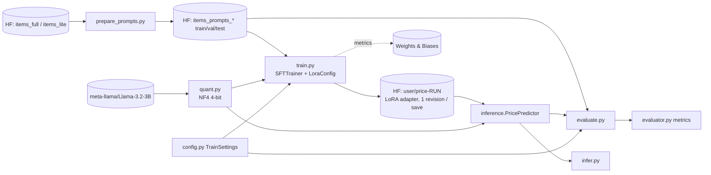
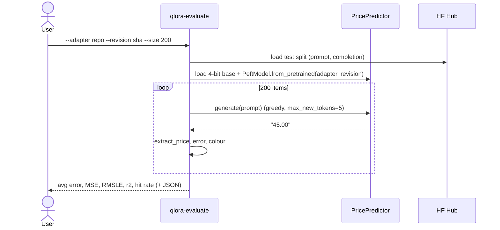

# Low-level design - price-predictor-qlora-training

## 1. Purpose & scope
Fine-tune an open-source causal LM with 4-bit **QLoRA** so that, given a product summary, it completes
`Price is $` with the price. Covers prompt-dataset creation, quantisation comparison, training (TRL `SFTTrainer` + PEFT LoRA),
checkpoint publishing to the HF Hub, experiment tracking (W&B), evaluation and single-item inference.
Out of scope: dataset curation (`price-dataset-and-baselines`), frontier fine-tuning (`price-predictor-openai-finetune`),
serving on Modal and agent applications.

## 2. Requirements
| # | Requirement |
|---|---|
| R1 | Build `items_prompts_{full,lite}` (prompt/completion) from the summarised items, truncating summaries to a token budget. |
| R2 | Load the base model at 4-bit/8-bit/16-bit and report memory (and optionally error). |
| R3 | Train a LoRA adapter on a 4-bit base with completion-only loss; evaluate on a val subset during training. |
| R4 | Push every checkpoint to `<user>/price-<run>` (revisions) and record the final revision. |
| R5 | Evaluate any adapter revision on the test split; compute avg error, MSE, RMSLE, r2, hit rate. |
| R6 | Infer a price for a free-text description with the same recipe used for training. |
| R7 | All configuration pure-logic testable offline; heavy imports lazy. |

## 3. Component diagram


## 4. Modules & signatures
| Module | Responsibility / API |
|---|---|
| `config.py` | Constants (`BASE_MODEL`, `CUTOFF=110`, `MAX_SEQ_LENGTH=160`, `QUESTION`, `PREFIX`), name helpers `items_dataset/prompts_dataset(lite,user)`, `make_run_name(now)`, `hub_model_id(user, run, project)`, `choose_compute_dtype(req, bf16_supported)`, dataclasses `LoraSettings`, `TrainSettings` with `.sft_kwargs(bf16)`, `.lora_kwargs()`, `.steps_per_epoch(n)`, `.validate()`, `.to_dict()` |
| `items.py` | `Item` (hub schema + `prompt`, `completion`), `make_prompts(tokenizer, max_tokens, do_round)`, `count_tokens`, `count_prompt_tokens`, `to_datapoint`, `from_hub` |
| `prompts.py` | `make_inference_prompt(summary, tokenizer=None, cutoff)`, `build_prompt_splits`, `truncation_stats`, `push_prompts_to_hub` |
| `parse.py` | `extract_price(text) -> float` |
| `quant.py` | `PRESETS`, `bnb_kwargs(preset, compute_dtype)`, `make_quant_config`, `load_base_model(base, preset, dtype) -> (tokenizer, model)`, `footprint_mb` |
| `train.py` | `build_parser`, `settings_from_args`, `run_training(settings, args)`, `main` (`--dry-run`) |
| `inference.py` | `PricePredictor(base_model, adapter, revision, quant, compute_dtype, max_new_tokens, seed)`: `generate(prompt)`, `__call__`, `price(description)`, `from_loaded(tokenizer, model)` |
| `evaluator.py` | `color_for`, `compute_metrics -> Metrics`, `title_of`, `Tester(predictor, data, size).run()/rows()/dump()` |
| `prepare_prompts.py`, `quant_compare.py`, `evaluate.py`, `infer.py` | CLIs |

## 5. Data models
**Hub items row (input)**: `title, category, price, full, weight, summary, prompt, id` (extra columns ignored).

**Prompt dataset (output of `qlora-prepare-prompts`)** - splits `train`, `val`, `test`; columns `prompt`, `completion`:
```
prompt     = "What does this cost to the nearest dollar?\n\n{summary, <=110 tokens}\n\nPrice is $"
completion = "50.00"            # train/val: f"{round(price)}.00"
completion = "49.6"             # test: str(price) (unrounded, used as ground truth)
```
Summary token budget: `CUTOFF=110`; a prompt + completion is then < 160 tokens, so `max_length=160` avoids truncating the price.
Truncation is by tokenizer tokens (`decode(tokens[:110]).rstrip()`), using the *base model's* tokenizer.

**Adapter repo** `<user>/price-<RUN_NAME>`: `adapter_config.json` (base_model_name_or_path = base model), `adapter_model.safetensors`, `README.md`; each saved checkpoint = one commit (`hub_strategy="every_save"`; optimizer state in `last-checkpoint/`).

**`run.json`**: `{settings: TrainSettings.to_dict(), adapter_dir, train_rows, latest_revision}`.

**Evaluation JSON** (`--output`): `{title, metrics:{n,average_error,mse,rmsle,r2_percent,hit_rate,green,orange,red}, rows:[{title,truth,guess,raw}]}`.

## 6. Sequence diagrams
Training:
```mermaid
sequenceDiagram
  actor U as User
  participant T as qlora-train
  participant H as HF Hub
  participant Q as quant.load_base_model
  participant S as SFTTrainer
  participant W as W&B
  U->>T: qlora-train [--lite]
  T->>T: TrainSettings.validate()
  T->>H: load_dataset(items_prompts_*) ; select eval rows
  T->>Q: 4-bit NF4 (double quant) base + tokenizer(pad=eos, right)
  T->>S: SFTTrainer(model, train, eval, LoraConfig, SFTConfig, tokenizer)
  loop every step
    S->>W: loss / lr / grad norm
  end
  loop every save_steps
    S->>S: eval loss on val subset
    S->>H: push adapter checkpoint (new revision)
  end
  T->>H: push final adapter ; list_repo_commits -> run.json
```
Evaluation / inference:


## 7. QLoRA training pipeline
* **Base model**: `meta-llama/Llama-3.2-3B` (override with `BASE_MODEL`; 8B possible with more VRAM). Typical precisions compared: bf16/fp16 (about 2 bytes/param), 8-bit (about 1), 4-bit NF4 (about 0.5) - `qlora-quant-compare` prints `get_memory_footprint()` for each.
* **Quantisation**: `BitsAndBytesConfig(load_in_4bit=True, bnb_4bit_use_double_quant=True, bnb_4bit_quant_type="nf4", bnb_4bit_compute_dtype=bf16|fp16)`. Compute dtype auto-selected (bf16 on Ampere+, fp16 on T4). Serving uses fp16 compute.
* **LoRA**: `r=32, lora_alpha=64, lora_dropout=0.1, bias="none", task_type=CAUSAL_LM`, targets `q_proj,k_proj,v_proj,o_proj`. Trainable parameters: per layer r*(in+out) summed over 4 projections; Llama 3.2 3B (hidden 3072, kv 1024, 28 layers) = 655,360 x 28 = 18,350,080 (about 0.57%).  Llama 3.1 8B: 851,968 x 32 = 27.3M. SFTTrainer calls `prepare_model_for_kbit_training` for quantised models.
* **Objective**: causal-LM cross entropy on the **completion tokens only** (`completion_only_loss=True`, prompt masked), prompt/completion dataset format, EOS appended by TRL.
* **Optimisation**: `paged_adamw_32bit`, lr 1e-4, cosine schedule, warm-up 3%, weight decay 0.01, grad clip 0.3, 1 epoch, per-device batch 16 x grad-accum 1 (effective 16; Colab T4: 4 x 4), seed 42, bf16/fp16 mixed precision.
* **Eval during training**: eval loss on the first 1,000 val rows every 2,000 steps (`eval_strategy="steps"`).
* **Checkpointing**: `save_steps=2000`, `push_to_hub=True`, `hub_strategy="every_save"`, private repo. 800k rows -> 50,000 steps -> 25 checkpoints; 20k rows -> 1,250 steps: `TrainSettings.adapt_to_dataset` then lowers eval/save intervals to total_steps/4 so short runs still evaluate and push checkpoints.
* **Tracking**: `report_to="wandb"`, `WANDB_PROJECT=price`, run name = timestamp.
* **Inference**: tokenizer pad = eos; `generate(do_sample=False, max_new_tokens=5)`; only generated tokens are decoded; number extracted by regex (`,` removed). A serving stack may decode the whole sequence and splits on `Price is $` - equivalent.
* **Metrics**: avg absolute error (headline), MSE, RMSLE, r2, hit rate (green share). Colours: green err<$40 or <20%; orange <$80 or <40%; red else.
* **Reference results**: base 4-bit 110.72; fine-tuned lite 65.40; fine-tuned full 39.85 (avg error on 200 test items).

## 8. Error handling
* `TrainSettings.validate()`: refuses pushing without `HF_USERNAME`, non-positive batch settings, `max_length < CUTOFF + 30` (would truncate the answer).
* `run_training` exits with a clear message if no CUDA GPU; warns if W&B key is missing; hub-listing failures after training are non-fatal.
* `extract_price` returns 0 for unparseable output (counted as an error, not a crash); `qlora-evaluate` requires `--adapter` or `--base-only`.
* Resume after Colab disconnect: `--resume-from-checkpoint` (Trainer state restored from the local `output_dir`).

## 9. Configuration
Env: `HF_TOKEN`, `HF_USERNAME`, `DATASET_USERNAME`, `WANDB_API_KEY`, `WANDB_PROJECT`, `BASE_MODEL`. Everything else through `qlora-train` flags -> `TrainSettings`.

## 10. Cost / time notes (estimates, not measured here)
Lite (20k rows): minutes to ~1 h on a T4/A100, a few cents to ~$1 of compute. Full (800k rows, 50k steps): several hours on an A100 (Colab Pro / Modal / RunPod: tens of dollars). Evaluation of 200 items: minutes (sequential generation).
Adapter size ~70 MB (fp32) so hub storage with 25 revisions is ~2 GB+ if optimizer state is included - delete unused revisions/branches.

## 11. Limitations
* Hyper-parameters are standard QLoRA defaults chosen as sensible defaults; tune with `--lr`, `--lora-r`, `--epochs`.
* Greedy decoding of digits ignores the model's probability distribution; a probability-weighted expectation over the top tokens (an extension) often reduces error.
* Sequential evaluation (no batched generation) is slow for large test sets.
* bitsandbytes needs Linux + NVIDIA; no Apple-silicon/CPU path for training.
* Summaries are truncated at 110 tokens of the base tokenizer: a different base model changes what gets cut.
* TRL/Transformers APIs move fast; verified with transformers 4.57 / trl 0.29 / peft 0.19.
