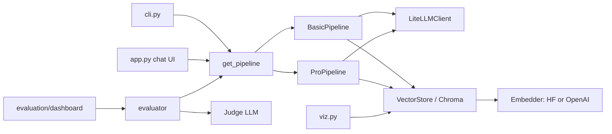
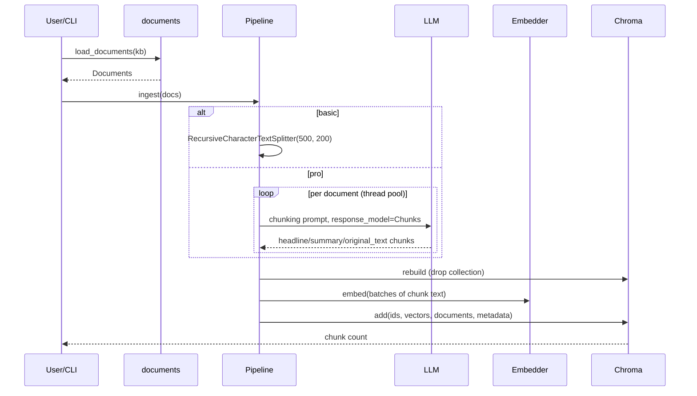
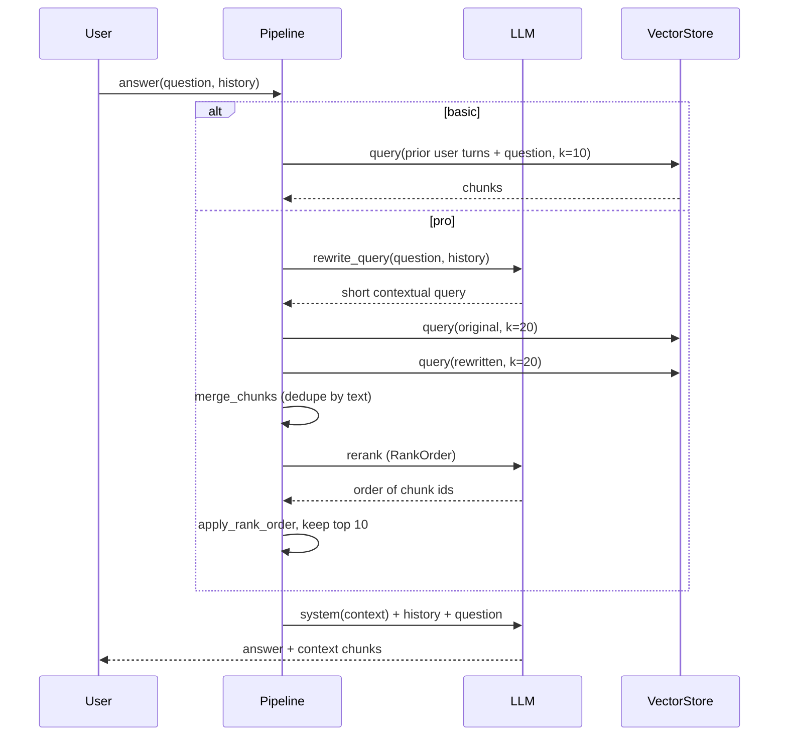

# Low-Level Design: RAG Knowledge Assistant

## 1. Purpose and scope

Answer questions about the fictional company Insurellm (company info, contracts, employees, products) from a markdown knowledge base, with two quality/cost tiers behind one interface, plus tooling to measure retrieval and answer quality. In scope: ingestion, retrieval, answering, evaluation, chat UI, evaluation dashboard, vector visualization. Out of scope: auth, multi-tenant stores, streaming, incremental re-indexing, hybrid (BM25) search.

## 2. Requirements

Functional
- F1 Ingest `data/knowledge-base/<type>/**/*.md` into a persistent vector store, per pipeline.
- F2 `basic` and `pro` pipelines behind one `Pipeline` interface, selectable by CLI flag, env var or UI radio.
- F3 Conversational answers using chat history.
- F4 Return retrieved chunks with source metadata for display and evaluation.
- F5 Evaluate retrieval (MRR, nDCG, keyword coverage) and answers (LLM judge: accuracy, completeness, relevance) on `tests.jsonl`.
- F6 Optional t-SNE visualization.

Non-functional
- N1 Self-contained, no external repo dependency.
- N2 All external clients (LLM, embeddings) injectable so tests run offline.
- N3 Resilience to rate limits and malformed LLM output.

## 3. Modules

| Module | Responsibility |
|---|---|
| `config.py` | `Settings` dataclass, env loading, per-pipeline paths/models |
| `models.py` | Pydantic models: `Document`, `Result`, `Chunk`, `Chunks`, `RankOrder`, `TestQuestion`, `RetrievalEval`, `AnswerEval` |
| `documents.py` | `load_documents(kb) -> list[Document]` |
| `llm.py` | `LLM` protocol, `LiteLLMClient` (retry, structured output) |
| `embeddings.py` | `Embedder` protocol, `OpenAIEmbedder`, `HFEmbedder`, `make_embedder(spec)` |
| `store.py` | `VectorStore` over Chroma: `rebuild`, `query`, `count`, `get_all` |
| `pipelines/basic.py` | `BasicPipeline`, `create_chunks`, `combined_question` |
| `pipelines/pro.py` | `ProPipeline`, `merge_chunks`, `apply_rank_order`, prompts |
| `evaluation/metrics.py` | `calculate_mrr`, `calculate_ndcg`, `evaluate_retrieval_docs`, `load_tests` |
| `evaluation/evaluator.py` | retrieval/answer evaluation loops, judge prompt, summaries |
| `evaluation/dashboard.py` | Gradio dashboard |
| `app.py` | Gradio chat UI |
| `viz.py` | t-SNE figure builder |
| `cli.py` | `rag ingest|ask|chat|eval|viz` |

## 4. Key signatures

```python
class Pipeline(ABC):
    def ingest(self, documents: list[Document]) -> int
    def fetch_context(self, question: str, history: list[dict] | None = None) -> list[Result]
    def answer(self, question: str, history: list[dict] | None = None) -> tuple[str, list[Result]]

class LLM(Protocol):
    def chat(self, messages: list[dict], response_model: type[T] | None = None) -> str | T
class Embedder(Protocol):
    name: str
    def embed(self, texts: list[str]) -> list[list[float]]
class VectorStore:
    def rebuild(self, chunks: list[Result]) -> int
    def query(self, text: str, k: int) -> list[Result]
get_pipeline(name, settings=None, *, llm=None, embedder=None, store=None) -> Pipeline
```

## 5. Data models

```mermaid
classDiagram
  class Document { source; type; text }
  class Result { page_content; metadata{source,type} }
  class Chunk { headline; summary; original_text; as_result(doc) Result }
  class Chunks { chunks: list~Chunk~ }
  class RankOrder { order: list~int~ }
  class TestQuestion { question; keywords; reference_answer; category }
  class RetrievalEval { mrr; ndcg; keywords_found; total_keywords; keyword_coverage }
  class AnswerEval { feedback; accuracy; completeness; relevance }
  Chunks o-- Chunk
  Chunk ..> Result : as_result
  Document ..> Chunk : source of
```

A stored pro chunk's text is `headline + summary + original_text`, so the embedding captures the high-level meaning (headline/summary) while the answer still has the verbatim text.

## 6. Component diagram



## 7. Ingestion flow



## 8. Query flow



## 9. Prompts and rationale

- **Basic system prompt**: friendly Insurellm persona; "if relevant use context; if you don't know say so" limits hallucination while still allowing small talk.
- **Chunking prompt (pro)**: asks for full coverage, overlap (~25%), a minimum chunk count scaled by document length (`len/100 + 1`), and for each chunk a headline, summary, and verbatim text. Headlines/summaries bridge the vocabulary gap between user questions and raw text; overlap protects facts that straddle boundaries.
- **Rewrite prompt**: condenses history + question into one short, self-contained query (with a coreference example) so follow-ups like "what role does she cover?" retrieve correctly. The original question is retrieved too so rewrite errors are not fatal.
- **Rerank prompt**: given retrieved order (approximately relevant), return all ids sorted by relevance as structured `RankOrder`. LLM reranking trades extra latency for precision over pure vector distance.
- **Pro answer prompt**: tells the model it is graded on accuracy, relevance and completeness, so it answers only and fully; each chunk is tagged `Extract from <source>`.
- **Judge prompt**: compares generated vs reference answer, strict 5/5 policy, wrong answer forces accuracy 1; structured `AnswerEval` output.

## 10. Evaluation design

Test set: 150 JSONL rows `{question, keywords, reference_answer, category}` (categories such as direct_fact, spanning, temporal).

Retrieval, for each keyword (case-insensitive substring match in chunk text), averaged over keywords:
- **MRR** = 1/rank of first chunk containing the keyword, else 0.
- **nDCG@k** with binary relevance (chunk contains keyword); DCG = sum rel_i / log2(i+1); IDCG from the sorted relevances of the retrieved list (so it measures ordering of what was retrieved, not misses).
- **Keyword coverage** = % keywords found in top-k (k=10). This is the metric that captures misses.

Answer quality: **LLM-as-judge** returns accuracy, completeness, relevance (1-5) plus feedback.

Dashboard colour thresholds: MRR/nDCG green >= 0.9, amber >= 0.75; coverage 90/75 %; answer scores 4.5/4.0. Results are aggregated overall and by category (bar charts).

Caveat: keyword matching is a proxy for relevance; the judge model and the answer model may be the same family, which can bias scores.

## 11. Error handling

- LLM calls: tenacity retry (exponential backoff, 5 attempts) then re-raise; structured outputs validated by Pydantic (a malformed reply is retried).
- Rerank robustness: `apply_rank_order` drops out-of-range and duplicate ids and appends omitted chunks, so a sloppy ranking never loses context (the original code would raise or drop chunks).
- Empty store: `VectorStore.query` raises a clear "run ingest" error; the chat UI shows errors in the conversation instead of crashing.
- Missing KB dir: `FileNotFoundError`; unknown embedding spec / pipeline: `ValueError`; missing sentence-transformers: actionable `ImportError`.

## 12. Configuration

See `config.Settings` and `.env.example`. Defaults: basic chunk 500/200, k=10; pro retrieval 20, final 10, 3 chunking workers, embed batch 100. Vector DBs live in `data/vector_db/<pipeline>` so tiers never share incompatible embeddings.

## 13. Extensibility

- New pipeline: subclass `Pipeline`, register in `get_pipeline`, add it to `PIPELINES`.
- New model/provider: any litellm model id; new embedder: implement `Embedder` and extend `make_embedder`.
- New metrics: add functions to `evaluation/metrics.py`; dashboard summaries are in `evaluator.py`.
- New corpus: point `RAG_DATA_DIR` at a folder with `knowledge-base/<type>/*.md` and `tests.jsonl`.

## 14. Limitations and cost

- Pro ingestion output is non-deterministic and LLM chunks are not verified to be verbatim or complete.
- Basic retrieval concatenates all user turns, which can drift in long chats.
- `rebuild` re-embeds everything; no incremental updates.
- Evaluation is sequential (150 tests x several LLM calls); expect minutes and non-trivial token spend with pro.
- The reranker sees up to 40 chunks in one prompt; very large chunks may exceed context.
