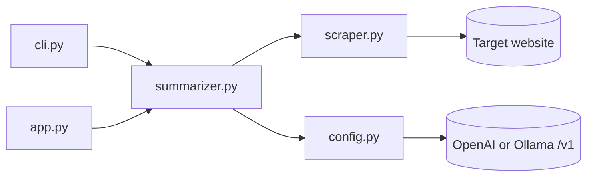
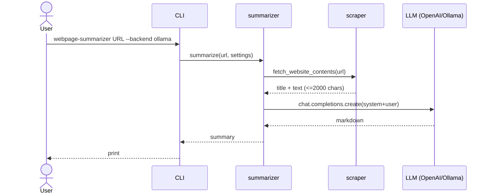

# Webpage Summarizer - Low-Level Design

## 1. Purpose and scope
A small tool that turns a URL into a short LLM-written summary. It demonstrates the minimal "scrape -> prompt -> chat completion" loop  and swapping the model provider with no code change by using an OpenAI-compatible endpoint (Ollama).
Out of scope: JavaScript-rendered pages, crawling, caching, multi-page summarization (see `company-brochure-generator`).

## 2. Requirements
- F1: Given a URL, return a markdown summary ignoring navigation text.
- F2: Select backend (OpenAI or Ollama) and model by flag or env var.
- F3: CLI and Gradio UI; UI streams.
- N1: No secrets in code; config from `.env`.
- N2: Tests run offline.
- N3: Clear errors for bad URL, missing key, unreachable Ollama.

## 3. Components
| Module | Responsibility |
|---|---|
| `config.py` | Read env, produce `Settings`, build `OpenAI` client |
| `scraper.py` | `fetch_website_contents` - HTTP GET, BeautifulSoup text extraction, truncation |
| `summarizer.py` | Prompts, `messages_for`, `summarize`, `stream_summary` |
| `cli.py` | argparse front-end |
| `app.py` | Gradio Blocks UI |



## 4. Signatures and data models
```python
@dataclass(frozen=True) class Settings: backend: str; model: str; base_url: str|None; api_key: str|None
def load_settings(backend: str|None=None, model: str|None=None) -> Settings
def make_client(settings: Settings) -> OpenAI
class ScrapeError(RuntimeError)
def fetch_website_contents(url: str, max_chars: int = 2000) -> str   # "title\n\nbody text"
def messages_for(website: str, system_prompt: str = SYSTEM_PROMPT) -> list[dict]
def summarize(url, settings=None, client=None, system_prompt=..., max_chars=2000) -> str
def stream_summary(...) -> Iterator[str]    # cumulative text
```
`client` is injectable, which is how tests substitute a fake.

## 5. Main flow


## 6. Prompts
- **System**: "snarky assistant ... short, snarky, humorous summary, ignoring navigation text ... markdown, no code block". Sets tone and output format (edit the last sentence to change behaviour, e.g. "Respond in Spanish").
- **User**: fixed prefix asking for a summary plus news/announcements, followed by the page text.
Page text is capped at 2000 chars to control cost/latency and fit small local models.

## 7. Error handling
- `ScrapeError` wraps `requests` failures and non-2xx responses (non-2xx responses, e.g. 403s, are surfaced rather than ignored).
- Missing `OPENAI_API_KEY` -> `RuntimeError` with remediation hint.
- Unknown backend -> `ValueError`.
- Gradio handler converts all of the above and SDK errors into a message in the output pane; CLI exits 1.

## 8. Configuration
See README table. Precedence: CLI flag > env/.env > default. `load_dotenv(override=True)`.

## 9. External dependencies
openai (client for both backends), requests, beautifulsoup4, python-dotenv, gradio.

## 10. Extensibility
- Another OpenAI-compatible provider: set `OPENAI_BASE_URL` + `OPENAI_API_KEY` + `OPENAI_MODEL` (Gemini, Groq, DeepSeek...).
- Swap the scraper for Selenium/Playwright to support JS pages; keep the same function signature.

## 11. Limitations and costs
- No JS rendering; some CDNs return 403.
- Truncation drops content past 2000 chars.
- Small local models give lower-quality, sometimes ignoring "no code block".
- OpenAI cost: one short call (a few thousand input tokens) per summary - fractions of a cent with `gpt-4.1-mini`.

## 12. Prerequisites: how the models are trained
Not applicable: this project only consumes pre-trained chat models through an API. For a hands-on look at training/fine-tuning of LLMs, see the sibling fine-tuning projects.
